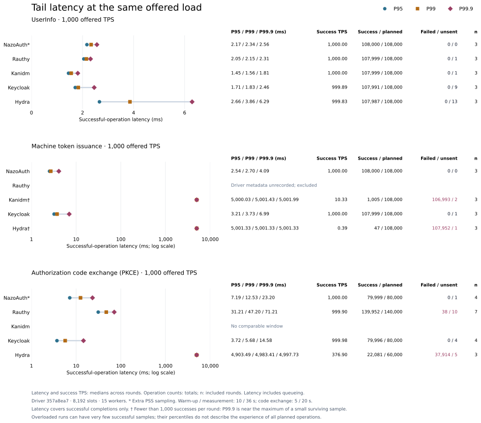
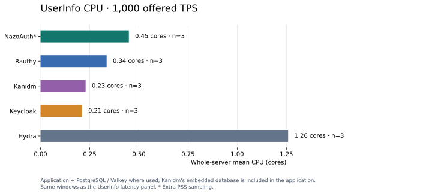
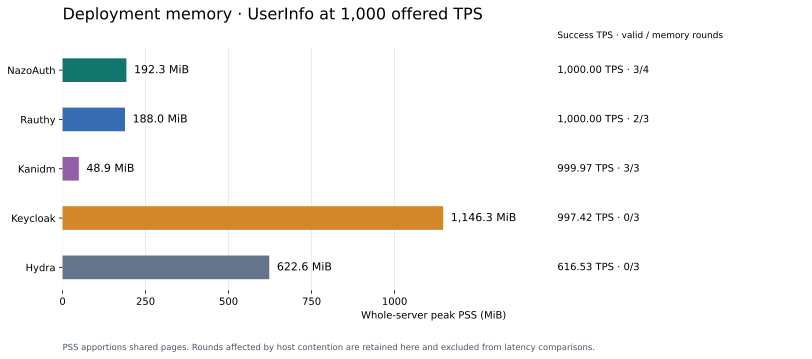

# OAuth / OIDC single-instance benchmark

[简体中文](README.zh_CN.md)

**Measured build: [`33984220`](https://github.com/nazozero/NazoAuth/commit/33984220ed1f48228e4b0f4ed8c345c2f63feb3b) + [token-endpoint quota switch patch](fixture/token-ip-quota.patch). Subsequent changes in PR #310 have not been retested in the five-service benchmark.**

The application uses **8 physical cores, one logical CPU per core**. PostgreSQL, Valkey and the load generator use separate cores. One OAuth service runs at a time; Goose 0.19.2 schedules real protocol requests at a fixed arrival rate.

**P95, P99 and P99.9 describe successful-operation latency, including queueing from the scheduled arrival.** Authorization and exchange may contain several HTTP requests per operation. The charts compare these percentiles at the same offered load and show successful, failed and unsent operation counts alongside them. Achieved TPS is load context; these measurements do not establish maximum sustainable throughput. `n` is the number of included rounds.

[Latency overview](#latency-overview) · [Deployment memory](#deployment-memory) · [Full results](#full-results) · [Test conditions](#test-conditions) · [Reproduction](#reproduction)

The archive contains **367 single-flow windows**: **358 are included** in the comparison, and 9 with conflicting rotation-driver evidence are retained separately. Among the included windows, 73 missed load or latency thresholds; **all 614,769 failed operations are counted**. Another 166 memory observations retain their measurement-quality labels.

## Latency overview



The panels use the same recorded driver (`357a8ea7`), 8,192 slots and 15 threads. Windows have the same duration within each flow. `*` marks extra PSS sampling for NazoAuth UserInfo and code exchange. The code-exchange and machine-issuance panels use logarithmic millisecond axes. Rauthy's single machine-issuance round at this rate lacks driver metadata; Kanidm has no comparable code-exchange window. Their records are not inserted into matched comparisons. Full results include other rates and driver groups; no refresh comparison containing NazoAuth has a shared recorded driver across services.

**Latency covers successful completions only.** Overloaded runs can have very few successful samples: machine issuance completed only **1,005 / 108,000** planned operations for Kanidm and **47 / 108,000** for Hydra. Each round had fewer than 1,000 successes, so its P99.9 lies near the largest successful sample. These percentiles do not describe all planned operations. The chart shows success / planned counts and failed / unsent totals to keep that distinction visible.

NazoAuth's nine UserInfo memory observations at 12,000 offered TPS all failed performance-validity checks: **no valid performance measurement is available at that rate**. NazoAuth machine issuance at 3,000 TPS and Rauthy at 1,000 TPS each have only one valid round, retained in the full results.

### UserInfo CPU



## Deployment memory



PSS apportions shared pages across processes. PostgreSQL shared pages appear in several processes' RSS, so summed RSS is not physical memory usage. These memory observations include rounds affected by host contention; achieved TPS and performance-valid round counts are shown alongside them. Invalid rounds do not enter the latency comparison. Each service retains its own business data. [Raw memory observations](evidence/protocol-memory.jsonl) · [Linux memory accounting](https://docs.kernel.org/filesystems/proc.html)

<details>
<summary>Scenario coverage</summary>

| Flow / measured offered TPS | NazoAuth | Rauthy | Kanidm | Keycloak | Hydra |
|---|---|---|---|---|---|
| Machine token issuance | 100; 1,000; 3,000; 6,000 | 12; 100; 1,000; 3,000; 6,000 | 12; 100; 1,000 | 12; 100; 1,000; 2,000; 3,000 | 12; 100; 550; 1,000 |
| Machine token introspection | 100; 1,000; 3,000; 6,000 | 100; 1,000; 3,000; 6,000; 9,000; 12,000 | 100; 1,000; 3,000; 6,000; 12,000 | 100; 1,000; 3,000; 12,000 | 100; 1,000; 3,000; 6,000 |
| User token introspection | 1,000 | 1,000 | 1,000 | 1,000 | 1,000 |
| UserInfo | 100; 1,000; 3,000; 6,000 | 100; 1,000; 3,000; 6,000; 12,000 | 100; 1,000; 3,000; 6,000; 12,000 | 100; 1,000; 3,000; 6,000; 12,000 | 100; 1,000; 3,000; 6,000; 12,000 |
| Authorization code exchange (PKCE) | 100; 1,000; 3,000 | 100; 1,000; 3,000 | — | 100; 1,000; 3,000 | 100; 1,000 |
| Refresh token rotation | 1,000; 3,000 | — | — | 100; 1,000; 3,000 | 100; 1,000 |
| Signed-in silent authorization + exchange | 100; 1,000 | 100; 1,000 | 100; 1,000 | 100 | — |
| Signed-in authorization + exchange (explicit consent) | 100; 1,000 | — | — | 100 | — |

— means no valid measurement with the shared semantics. Round counts appear in the full results.

</details>

## Full results

Each row groups one product build, flow, token-family size, recorded driver binary and parameters, and sampling method. Unknown driver parameters form separate groups. Latency percentiles, throughput, CPU and memory are medians across rounds; Max is the maximum across all rounds. **Failures and unsent operations are totals across the displayed rounds.** The final column lists total rounds / rounds with successful latency samples / rounds with a raw ledger. The driver column shows the first eight SHA-256 characters, in-flight slots and worker threads. `?` means unrecorded; single rounds are marked.

<details>
<summary>Machine token issuance</summary>

| Offered TPS | Service | Sampling | Driver / slots / threads | Sent / successful TPS | Failed / unsent totals | P50 / P95 / P99 / P99.9 / Max ms | CPU app / total (cores) | RSS app / total MiB | PSS app / total MiB | Host PSI range % | Rounds / latency / raw |
|---|---|---|---|---|---|---|---|---|---|---|---|
| 12 | Rauthy | Standard | be0010eb / 8192 / 15 | 12.00 / 12.00 | 0 / 0 | 3.96 / 5.09 / 7.82 / 12.25 / 55.65 | 0.02 / 0.03 | 80.3 / 499.6 | — | 0.05–10.26 | 3 / 3 / 0 |
| 12 | Kanidm | Standard | ? / ? / ? | 12.00 / 12.00 | 0 / 0 | 11.12 / 24.60 / 65.84 / 173.28 / 312.13 | 0.08 / 0.08 | 66.8 / 66.8 | — | 0.06–0.27 | 2 / 2 / 0 |
| 12 | Kanidm | Standard | be0010eb / 8192 / 15 | 12.00 / 12.00 | 0 / 0 | 11.09 / 24.65 / 49.12 / 220.33 / 220.33 | 0.09 / 0.09 | 114.9 / 114.9 | — | 6.55–6.55 | 1 / 1 / 0 (single round) |
| 12 | Keycloak | Standard | be0010eb / 8192 / 15 | 12.00 / 12.00 | 0 / 0 | 6.66 / 8.35 / 9.60 / 33.68 / 56.35 | 0.13 / 0.13 | 816.1 / 1,041.0 | — | 0.19–11.36 | 3 / 3 / 0 |
| 12 | Hydra | Standard | be0010eb / 8192 / 15 | 12.00 / 12.00 | 0 / 0 | 9.15 / 10.86 / 13.94 / 16.11 / 32.01 | 0.09 / 0.10 | 51.8 / 261.0 | — | 0.10–0.45 | 3 / 3 / 0 |
| 100 | NazoAuth | Standard | 357a8ea7 / 8192 / 15 | 100.00 / 100.00 | 0 / 0 | 1.38 / 2.10 / 2.23 / 2.63 / 5.29 | 0.04 / 0.08 | 21.7 / 560.0 | — | 0.14–0.23 | 3 / 3 / 3 |
| 100 | Rauthy | Standard | ? / ? / ? | 100.00 / 100.00 | 0 / 0 | 3.53 / 5.74 / 8.26 / 12.69 / 13.73 | 0.17 / 0.19 | 82.2 / 691.3 | — | 0.09–0.09 | 1 / 1 / 0 (single round) |
| 100 | Rauthy | Standard | be0010eb / 8192 / 15 | 100.00 / 100.00 | 0 / 0 | 3.21 / 5.46 / 8.81 / 15.36 / 22.64 | 0.16 / 0.18 | 81.5 / 527.5 | — | 0.31–2.00 | 2 / 2 / 0 |
| 100 | Kanidm | Standard | be0010eb / 8192 / 15 | 100.00 / 18.81 | 15,522 / 1 | 3,444.72 / 4,998.66 / 5,000.82 / 5,001.78 / 5,002.37 | 0.62 / 0.62 | 328.1 / 328.1 | — | 0.04–10.15 | 6 / 3 / 0 |
| 100 | Keycloak | Standard | be0010eb / 8192 / 15 | 100.00 / 100.00 | 0 / 0 | 2.80 / 3.82 / 4.40 / 7.19 / 14.31 | 0.40 / 0.41 | 886.4 / 1,100.4 | — | 0.14–0.69 | 3 / 3 / 0 |
| 100 | Hydra | Standard | ? / ? / ? | 100.00 / 100.00 | 0 / 0 | 8.78 / 12.04 / 16.60 / 43.73 / 72.60 | 0.71 / 0.75 | 58.0 / 1,208.3 | — | 0.21–0.21 | 1 / 1 / 0 (single round) |
| 100 | Hydra | Standard | be0010eb / 8192 / 15 | 100.00 / 100.00 | 0 / 0 | 7.88 / 9.61 / 13.05 / 17.58 / 26.38 | 0.68 / 0.71 | 56.6 / 384.3 | — | 0.25–1.24 | 2 / 2 / 0 |
| 550 | Hydra | Standard | ? / ? / ? | 549.97 / 422.25 | 4,598 / 1 | 8.43 / 12.87 / 18.08 / 68.17 / 5,001.50 | 3.28 / 3.41 | 314.4 / 2,496.0 | — | 0.31–0.31 | 1 / 1 / 0 (single round) |
| 1,000 | NazoAuth | Standard | 357a8ea7 / 8192 / 15 | 1,000.00 / 1,000.00 | 0 / 0 | 1.60 / 2.54 / 2.70 / 4.09 / 13.66 | 0.41 / 0.57 | 23.2 / 737.7 | — | 0.13–0.31 | 3 / 3 / 3 |
| 1,000 | Rauthy | Standard | ? / ? / ? | 1,000.00 / 1,000.00 | 0 / 0 | 4.97 / 13.25 / 21.82 / 42.28 / 60.66 | 1.55 / 1.69 | 85.5 / 1,876.1 | — | 0.22–0.22 | 1 / 1 / 0 (single round) |
| 1,000 | Kanidm | Standard | 357a8ea7 / 8192 / 15 | 999.97 / 10.33 | 106,993 / 2 | 4,817.54 / 5,000.03 / 5,001.43 / 5,001.99 / 5,002.09 | 0.75 / 0.75 | 568.5 / 568.5 | — | 0.53–1.10 | 3 / 3 / 3 |
| 1,000 | Keycloak | Standard | 357a8ea7 / 8192 / 15 | 1,000.00 / 1,000.00 | 0 / 1 | 2.27 / 3.21 / 3.73 / 6.99 / 35.90 | 1.44 / 1.48 | 1,030.4 / 1,930.1 | — | 0.36–0.76 | 3 / 3 / 3 |
| 1,000 | Hydra | Standard | 357a8ea7 / 8192 / 15 | 1,000.00 / 0.39 | 107,952 / 1 | 18.70 / 5,001.33 / 5,001.33 / 5,001.33 / 5,001.79 | 5.63 / 5.74 | 730.8 / 1,489.5 | — | 1.50–2.95 | 3 / 3 / 3 |
| 2,000 | Keycloak | Standard | ? / ? / ? | 1,999.94 / 1,999.94 | 0 / 2 | 2.02 / 2.68 / 3.22 / 7.48 / 22.21 | 2.69 / 2.80 | 1,010.5 / 2,962.6 | — | 0.19–0.19 | 1 / 1 / 0 (single round) |
| 3,000 | NazoAuth | Standard | ee4a059e / 8192 / 15 | 2,999.89 / 2,999.89 | 0 / 4 | 1.95 / 3.71 / 4.99 / 7.88 / 80.31 | 1.40 / 1.84 | 33.9 / 2,747.6 | — | 0.86–0.86 | 1 / 1 / 1 (single round) |
| 3,000 | Rauthy | Standard | ? / ? / ? | 2,375.72 / 2,375.72 | 0 / 22,474 | 3,665.88 / 3,897.74 / 3,963.20 / 3,991.95 / 4,059.62 | 3.15 / 3.34 | 390.9 / 2,100.7 | — | 0.14–0.14 | 1 / 1 / 0 (single round) |
| 3,000 | Keycloak | Standard | ? / ? / ? | 2,999.90 / 2,999.90 | 0 / 7 | 2.29 / 991.18 / 1,195.63 / 1,240.82 / 1,902.57 | 5.04 / 5.22 | 1,752.2 / 3,102.5 | — | 6.66–9.78 | 2 / 2 / 0 |
| 6,000 | NazoAuth | Standard | ee4a059e / 8192 / 15 | 6,000.00 / 6,000.00 | 0 / 6 | 1.80 / 3.41 / 4.10 / 6.83 / 15.92 | 2.32 / 3.24 | 33.5 / 2,703.5 | — | 1.08–1.70 | 3 / 3 / 3 |
| 6,000 | Rauthy | Standard | ee4a059e / 8192 / 15 | 2,048.03 / 2,048.03 | 0 / 428,002 | 4,016.70 / 4,186.62 / 4,227.17 / 4,252.46 / 4,312.47 | 2.74 / 2.98 | 380.5 / 2,193.2 | — | 0.76–2.16 | 3 / 3 / 3 |

</details>

<details>
<summary>Machine token introspection</summary>

| Offered TPS | Service | Sampling | Driver / slots / threads | Sent / successful TPS | Failed / unsent totals | P50 / P95 / P99 / P99.9 / Max ms | CPU app / total (cores) | RSS app / total MiB | PSS app / total MiB | Host PSI range % | Rounds / latency / raw |
|---|---|---|---|---|---|---|---|---|---|---|---|
| 100 | NazoAuth | Standard + PSS | 357a8ea7 / 8192 / 15 | 100.00 / 100.00 | 0 / 0 | 1.34 / 2.06 / 2.26 / 2.70 / 6.71 | 0.04 / 0.08 | 27.3 / 478.1 | 25.9 / 330.6 | 0.60–0.80 | 2 / 2 / 2 |
| 100 | Rauthy | Standard | ? / ? / ? | 100.00 / 100.00 | 0 / 0 | 1.08 / 1.83 / 2.00 / 2.43 / 3.04 | 0.04 / 0.05 | 82.2 / 706.9 | — | 0.16–0.16 | 1 / 1 / 0 (single round) |
| 100 | Rauthy | Standard | be0010eb / 8192 / 15 | 100.00 / 100.00 | 0 / 0 | 1.33 / 2.09 / 2.25 / 2.73 / 4.01 | 0.04 / 0.05 | 80.9 / 499.3 | — | 0.43–1.13 | 2 / 2 / 0 |
| 100 | Kanidm | Standard | ? / ? / ? | 100.00 / 100.00 | 0 / 0 | 1.15 / 2.02 / 2.17 / 2.45 / 2.72 | 0.01 / 0.01 | 50.9 / 50.9 | — | 0.06–0.06 | 1 / 1 / 0 (single round) |
| 100 | Kanidm | Standard | be0010eb / 8192 / 15 | 99.97 / 99.97 | 0 / 2 | 0.86 / 1.50 / 1.63 / 1.90 / 4.11 | 0.01 / 0.01 | 82.3 / 82.3 | — | 0.05–2.92 | 2 / 2 / 0 |
| 100 | Keycloak | Standard | be0010eb / 8192 / 15 | 100.00 / 100.00 | 0 / 0 | 2.01 / 3.03 / 3.55 / 5.12 / 11.45 | 0.26 / 0.27 | 893.0 / 1,119.3 | — | 0.13–0.96 | 3 / 3 / 0 |
| 100 | Hydra | Standard | ? / ? / ? | 100.00 / 100.00 | 0 / 0 | 1.93 / 2.71 / 3.11 / 3.88 / 4.87 | 0.13 / 0.15 | 56.0 / 1,049.2 | — | 0.21–0.21 | 1 / 1 / 0 (single round) |
| 100 | Hydra | Standard | be0010eb / 8192 / 15 | 100.00 / 100.00 | 0 / 0 | 1.89 / 2.65 / 3.07 / 3.79 / 5.85 | 0.13 / 0.15 | 56.0 / 260.5 | — | 0.04–1.73 | 2 / 2 / 0 |
| 1,000 | NazoAuth | Standard + PSS | 357a8ea7 / 8192 / 15 | 1,000.00 / 1,000.00 | 0 / 1 | 1.20 / 1.80 / 1.95 / 2.74 / 60.56 | 0.27 / 0.45 | 31.9 / 682.1 | 30.3 / 365.8 | 0.30–1.03 | 3 / 3 / 3 |
| 1,000 | Rauthy | Standard | ? / ? / ? | 1,000.00 / 1,000.00 | 0 / 0 | 1.18 / 1.85 / 2.02 / 2.45 / 5.15 | 0.35 / 0.41 | 79.8 / 638.7 | — | 13.36–13.36 | 1 / 1 / 0 (single round) |
| 1,000 | Rauthy | Standard | ? / 8192 / ? | 1,000.00 / 1,000.00 | 0 / 0 | 1.27 / 2.10 / 2.26 / 3.73 / 8.98 | 0.32 / 0.38 | 77.3 / 463.0 | — | 1.13–1.13 | 1 / 1 / 0 (single round) |
| 1,000 | Rauthy | Standard | be0010eb / 8192 / 15 | 999.97 / 999.97 | 0 / 1 | 1.27 / 2.05 / 2.16 / 2.37 / 5.70 | 0.33 / 0.36 | 80.1 / 503.7 | — | 0.24–0.24 | 1 / 1 / 0 (single round) |
| 1,000 | Kanidm | Standard | ? / ? / ? | 999.97 / 999.97 | 0 / 2 | 0.93 / 1.64 / 1.76 / 1.97 / 4.96 | 0.09 / 0.09 | 51.0 / 51.0 | — | 0.07–2.84 | 2 / 2 / 0 |
| 1,000 | Kanidm | Standard | be0010eb / 8192 / 15 | 999.28 / 999.28 | 0 / 26 | 1.20 / 2.11 / 2.24 / 3.88 / 19.48 | 0.09 / 0.09 | 77.0 / 77.0 | — | 8.47–8.47 | 1 / 1 / 0 (single round) |
| 1,000 | Keycloak | Standard | be0010eb / 8192 / 15 | 1,000.00 / 1,000.00 | 0 / 0 | 1.18 / 1.73 / 1.94 / 5.66 / 19.19 | 0.45 / 0.49 | 1,000.7 / 1,360.2 | — | 0.07–0.58 | 3 / 3 / 0 |
| 1,000 | Hydra | Standard | ? / ? / ? | 1,000.00 / 1,000.00 | 0 / 0 | 1.30 / 2.31 / 2.74 / 3.81 / 23.33 | 1.11 / 1.21 | 57.1 / 1,184.8 | — | 0.08–0.08 | 1 / 1 / 0 (single round) |
| 1,000 | Hydra | Standard | be0010eb / 8192 / 15 | 1,000.00 / 1,000.00 | 0 / 0 | 1.38 / 2.41 / 2.87 / 3.80 / 15.06 | 1.10 / 1.20 | 57.4 / 392.9 | — | 0.16–0.19 | 2 / 2 / 0 |
| 3,000 | NazoAuth | Standard + PSS | 357a8ea7 / 8192 / 15 | 3,000.00 / 3,000.00 | 0 / 4 | 1.43 / 2.72 / 3.02 / 3.97 / 20.85 | 0.69 / 1.40 | 33.3 / 1,090.5 | 31.8 / 385.2 | 0.29–0.41 | 3 / 3 / 3 |
| 3,000 | Rauthy | Standard | ? / ? / ? | 2,999.86 / 2,999.86 | 0 / 5 | 1.64 / 2.68 / 3.03 / 4.04 / 7.41 | 0.85 / 0.93 | 81.7 / 516.9 | — | 0.07–0.07 | 1 / 1 / 0 (single round) |
| 3,000 | Rauthy | Standard | be0010eb / 8192 / 15 | 2,999.90 / 2,999.90 | 0 / 7 | 1.18 / 2.19 / 2.54 / 2.91 / 7.12 | 0.78 / 0.86 | 82.1 / 514.4 | — | 0.29–0.30 | 2 / 2 / 0 |
| 3,000 | Kanidm | Standard | be0010eb / 8192 / 15 | 2,999.94 / 2,999.94 | 0 / 88 | 0.99 / 2.17 / 2.40 / 2.53 / 5.67 | 0.30 / 0.30 | 94.8 / 94.8 | — | 3.56–17.84 | 3 / 3 / 0 |
| 3,000 | Keycloak | Standard | ? / ? / ? | 2,999.94 / 2,999.94 | 0 / 4 | 1.13 / 2.01 / 2.35 / 8.90 / 30.54 | 1.34 / 1.47 | 1,012.2 / 2,249.1 | — | 0.18–0.24 | 2 / 2 / 0 |
| 3,000 | Keycloak | Standard | be0010eb / 8192 / 15 | 2,999.97 / 2,999.97 | 0 / 1 | 1.54 / 2.78 / 3.20 / 9.27 / 28.18 | 1.44 / 1.61 | 1,013.8 / 2,025.5 | — | 0.31–0.31 | 1 / 1 / 0 (single round) |
| 3,000 | Hydra | Standard | be0010eb / 8192 / 15 | 2,999.89 / 2,999.89 | 0 / 11 | 3.28 / 67.70 / 82.74 / 90.28 / 231.75 | 2.74 / 3.09 | 90.7 / 3,275.6 | — | 0.59–3.44 | 3 / 3 / 0 |
| 6,000 | NazoAuth | Standard + PSS | ee4a059e / 8192 / 15 | 5,999.94 / 5,999.94 | 0 / 6 | 1.26 / 2.17 / 2.49 / 4.25 / 16.19 | 1.12 / 2.94 | 35.1 / 2,110.8 | 33.6 / 1,215.9 | 0.53–1.74 | 3 / 3 / 3 |
| 6,000 | Rauthy | Standard | ee4a059e / 8192 / 15 | 5,999.89 / 5,999.89 | 0 / 4 | 1.57 / 2.70 / 3.08 / 5.69 / 10.46 | 1.58 / 1.85 | 85.3 / 974.6 | — | 8.09–8.09 | 1 / 1 / 1 (single round) |
| 6,000 | Kanidm | Standard | ee4a059e / 8192 / 15 | 5,999.92 / 5,999.92 | 0 / 16 | 0.88 / 1.95 / 2.27 / 2.37 / 5.22 | 0.48 / 0.48 | 58.3 / 58.3 | — | 0.52–6.09 | 3 / 3 / 3 |
| 6,000 | Hydra | Standard + PSS | 54e36521 / 8192 / 15 | 3,267.62 / 3,261.24 | 460 / 196,731 | 2,508.99 / 2,632.79 / 2,733.24 / 4,906.14 / 5,001.55 | 3.09 / 3.45 | 858.0 / 4,447.3 | 858.0 / 2,021.5 | 2.95–4.96 | 2 / 2 / 2 |
| 9,000 | Rauthy | Standard | ? / ? / ? | 8,999.78 / 8,999.78 | 0 / 8 | 1.65 / 3.00 / 3.78 / 6.18 / 20.32 | 2.37 / 2.64 | 85.0 / 1,382.1 | — | 0.10–0.10 | 1 / 1 / 0 (single round) |
| 12,000 | Rauthy | Standard | ? / ? / ? | 11,999.47 / 11,999.47 | 0 / 19 | 1.69 / 3.37 / 4.55 / 7.81 / 16.61 | 3.23 / 3.59 | 88.0 / 1,627.9 | — | 0.33–0.33 | 1 / 1 / 0 (single round) |
| 12,000 | Rauthy | Standard | ? / 8192 / ? | 11,999.58 / 11,999.58 | 0 / 15 | 1.71 / 3.32 / 4.20 / 5.76 / 16.83 | 3.06 / 3.38 | 87.3 / 1,285.7 | — | 0.68–0.68 | 1 / 1 / 0 (single round) |
| 12,000 | Kanidm | Standard | ee4a059e / 8192 / 15 | 11,999.94 / 11,999.94 | 0 / 17 | 0.85 / 1.40 / 1.52 / 2.01 / 5.17 | 0.88 / 0.88 | 59.0 / 59.0 | — | 0.62–1.25 | 3 / 3 / 3 |
| 12,000 | Keycloak | Standard | ? / ? / ? | 10,823.03 / 10,823.03 | 0 / 152,770 | 4.63 / 1,158.07 / 1,285.91 / 1,337.63 / 1,482.77 | 6.76 / 7.41 | 3,730.1 / 5,485.1 | — | 10.70–17.20 | 3 / 3 / 0 |
| 12,000 | Keycloak | Standard | ? / 8192 / ? | 11,177.67 / 11,177.67 | 0 / 29,604 | 2.13 / 1,031.58 / 1,130.66 / 1,183.00 / 1,221.82 | 6.42 / 7.01 | 3,951.6 / 4,863.8 | — | 29.04–29.04 | 1 / 1 / 0 (single round) |
| 12,000 | Rauthy | Wide | ab3fc072 / 32768 / 24 | 11,996.06 / 11,996.06 | 0 / 351 | 1.80 / 3.59 / 4.76 / 10.04 / 73.13 | 3.19 / 3.71 | 96.5 / 1,416.1 | — | 0.65–8.57 | 3 / 3 / 0 |
| 12,000 | Keycloak | Wide | ab3fc072 / 32768 / 24 | 10,205.67 / 10,205.67 | 2 / 192,014 | 2,297.65 / 4,392.94 / 4,790.36 / 4,876.01 / 4,979.88 | 7.79 / 8.49 | 4,836.9 / 5,646.9 | — | 18.57–21.58 | 3 / 3 / 0 |

</details>

<details>
<summary>User token introspection</summary>

| Offered TPS | Service | Sampling | Driver / slots / threads | Sent / successful TPS | Failed / unsent totals | P50 / P95 / P99 / P99.9 / Max ms | CPU app / total (cores) | RSS app / total MiB | PSS app / total MiB | Host PSI range % | Rounds / latency / raw |
|---|---|---|---|---|---|---|---|---|---|---|---|
| 1,000 | NazoAuth | Standard + PSS | 357a8ea7 / 8192 / 15 | 999.97 / 999.97 | 0 / 2 | 1.32 / 1.98 / 2.14 / 2.84 / 6.93 | 0.20 / 0.58 | 32.8 / 997.2 | 31.3 / 383.5 | 0.19–0.59 | 3 / 3 / 3 |
| 1,000 | Rauthy | Standard | ee4a059e / 8192 / 15 | 999.97 / 999.97 | 0 / 3 | 1.19 / 1.94 / 2.08 / 3.15 / 8.47 | 0.30 / 0.34 | 82.3 / 848.6 | — | 0.14–35.63 | 5 / 5 / 5 |
| 1,000 | Kanidm | Standard | ee4a059e / 8192 / 15 | 999.97 / 999.97 | 0 / 4 | 1.11 / 1.83 / 2.17 / 3.46 / 7.44 | 0.25 / 0.25 | 52.8 / 52.8 | — | 7.84–13.84 | 3 / 3 / 3 |
| 1,000 | Keycloak | Standard | 54e36521 / 8192 / 15 | 1,000.00 / 1,000.00 | 0 / 1 | 1.27 / 2.07 / 2.55 / 11.41 / 28.79 | 0.49 / 0.49 | 1,047.5 / 2,680.1 | — | 0.33–24.22 | 3 / 3 / 3 |
| 1,000 | Hydra | Standard | 357a8ea7 / 8192 / 15 | 999.99 / 999.99 | 0 / 1 | 1.83 / 2.90 / 3.53 / 5.68 / 17.79 | 1.26 / 1.35 | 61.8 / 2,686.1 | — | 0.66–1.64 | 2 / 2 / 2 |
| 1,000 | Hydra | Standard | 54e36521 / 8192 / 15 | 999.97 / 999.97 | 0 / 2 | 1.94 / 3.08 / 3.74 / 5.13 / 16.13 | 1.30 / 1.40 | 59.7 / 2,259.4 | — | 0.44–1.19 | 3 / 3 / 3 |

</details>

<details>
<summary>UserInfo</summary>

| Offered TPS | Service | Sampling | Driver / slots / threads | Sent / successful TPS | Failed / unsent totals | P50 / P95 / P99 / P99.9 / Max ms | CPU app / total (cores) | RSS app / total MiB | PSS app / total MiB | Host PSI range % | Rounds / latency / raw |
|---|---|---|---|---|---|---|---|---|---|---|---|
| 100 | NazoAuth | Standard + PSS | 357a8ea7 / 8192 / 15 | 100.00 / 100.00 | 0 / 0 | 1.59 / 2.25 / 2.44 / 2.80 / 11.29 | 0.03 / 0.09 | 31.8 / 640.7 | 30.4 / 192.5 | 0.16–1.45 | 4 / 4 / 4 |
| 100 | Rauthy | Standard | 357a8ea7 / 8192 / 15 | 100.00 / 100.00 | 0 / 0 | 1.40 / 2.04 / 2.20 / 2.43 / 3.38 | 0.04 / 0.05 | 81.6 / 502.3 | — | 0.24–0.29 | 3 / 3 / 0 |
| 100 | Kanidm | Standard | 357a8ea7 / 8192 / 15 | 100.00 / 100.00 | 0 / 1 | 1.11 / 1.56 / 1.71 / 1.98 / 5.33 | 0.03 / 0.03 | 84.5 / 84.5 | — | 0.04–6.55 | 3 / 3 / 0 |
| 100 | Keycloak | Standard | 357a8ea7 / 8192 / 15 | 100.00 / 100.00 | 0 / 2 | 1.42 / 2.20 / 2.76 / 4.37 / 12.40 | 0.17 / 0.17 | 1,034.6 / 1,616.5 | — | 0.08–4.73 | 3 / 3 / 0 |
| 100 | Hydra | Standard | 357a8ea7 / 8192 / 15 | 100.00 / 100.00 | 0 / 1 | 2.13 / 3.13 / 3.52 / 4.45 / 5.86 | 0.14 / 0.15 | 58.5 / 758.7 | — | 0.13–5.55 | 3 / 3 / 0 |
| 1,000 | NazoAuth | Standard + PSS | 357a8ea7 / 8192 / 15 | 1,000.00 / 1,000.00 | 0 / 0 | 1.37 / 2.17 / 2.34 / 2.56 / 6.18 | 0.11 / 0.45 | 32.0 / 656.0 | 30.5 / 193.7 | 0.24–2.15 | 3 / 3 / 3 |
| 1,000 | Rauthy | Standard | 357a8ea7 / 8192 / 15 | 1,000.00 / 1,000.00 | 0 / 1 | 1.24 / 2.05 / 2.15 / 2.31 / 5.56 | 0.30 / 0.34 | 82.4 / 505.2 | — | 0.19–0.32 | 3 / 3 / 0 |
| 1,000 | Kanidm | Standard | 357a8ea7 / 8192 / 15 | 1,000.00 / 1,000.00 | 0 / 1 | 0.91 / 1.45 / 1.56 / 1.81 / 6.27 | 0.23 / 0.23 | 90.6 / 90.6 | — | 0.08–5.08 | 3 / 3 / 0 |
| 1,000 | Keycloak | Standard | 357a8ea7 / 8192 / 15 | 999.89 / 999.89 | 0 / 9 | 1.04 / 1.71 / 1.83 / 2.46 / 5.76 | 0.21 / 0.21 | 1,018.9 / 1,662.1 | — | 0.05–5.50 | 3 / 3 / 0 |
| 1,000 | Hydra | Standard | 357a8ea7 / 8192 / 15 | 999.83 / 999.83 | 0 / 13 | 1.60 / 2.66 / 3.86 / 6.29 / 10.88 | 1.15 / 1.26 | 59.7 / 743.5 | — | 0.23–11.55 | 3 / 3 / 0 |
| 3,000 | NazoAuth | Standard + PSS | 357a8ea7 / 8192 / 15 | 2,999.94 / 2,999.94 | 0 / 12 | 1.13 / 1.91 / 2.11 / 2.88 / 28.90 | 0.35 / 1.29 | 32.9 / 666.1 | 31.5 / 195.3 | 0.23–1.07 | 6 / 6 / 6 |
| 3,000 | Rauthy | Standard | ? / ? / ? | 2,999.89 / 2,999.89 | 0 / 11 | 1.60 / 2.72 / 3.18 / 3.33 / 7.78 | 0.94 / 1.03 | 83.1 / 511.9 | — | 1.02–2.14 | 3 / 3 / 0 |
| 3,000 | Kanidm | Standard | ? / ? / ? | 2,999.94 / 2,999.94 | 0 / 7 | 1.02 / 1.67 / 1.83 / 2.12 / 4.96 | 0.77 / 0.77 | 65.5 / 65.5 | — | 1.28–1.77 | 3 / 3 / 0 |
| 3,000 | Keycloak | Standard | ? / ? / ? | 2,999.89 / 2,999.89 | 0 / 11 | 1.12 / 2.33 / 2.54 / 3.09 / 17.36 | 0.69 / 0.69 | 1,067.0 / 1,718.7 | — | 1.33–1.59 | 3 / 3 / 0 |
| 3,000 | Hydra | Standard | ? / ? / ? | 2,999.97 / 2,999.97 | 0 / 7 | 3.87 / 9.25 / 14.14 / 19.85 / 595.51 | 2.98 / 3.29 | 67.0 / 706.8 | — | 0.84–11.21 | 3 / 3 / 0 |
| 6,000 | NazoAuth | Standard + PSS | 357a8ea7 / 8192 / 15 | 5,999.94 / 5,999.94 | 0 / 11 | 1.25 / 2.15 / 2.41 / 3.54 / 17.35 | 0.61 / 2.86 | 34.3 / 991.0 | 32.8 / 233.1 | 0.32–1.81 | 5 / 5 / 5 |
| 6,000 | Rauthy | Standard | ? / ? / ? | 5,999.69 / 5,999.69 | 0 / 55 | 1.59 / 2.80 / 3.20 / 4.25 / 13.32 | 1.73 / 1.91 | 83.4 / 808.4 | — | 0.30–0.67 | 3 / 3 / 0 |
| 6,000 | Kanidm | Standard | ? / ? / ? | 5,999.92 / 5,999.92 | 0 / 13 | 1.13 / 1.96 / 2.21 / 2.69 / 6.11 | 1.54 / 1.54 | 63.7 / 63.7 | — | 0.15–1.39 | 3 / 3 / 0 |
| 6,000 | Keycloak | Standard | ? / ? / ? | 5,999.83 / 5,999.83 | 0 / 28 | 1.05 / 1.73 / 2.00 / 7.15 / 27.02 | 1.24 / 1.24 | 1,230.4 / 1,953.9 | — | 0.71–1.78 | 3 / 3 / 0 |
| 6,000 | Hydra | Standard | ? / ? / ? | 3,286.06 / 3,280.19 | 998 / 294,722 | 2,499.90 / 2,560.83 / 2,580.25 / 4,983.09 / 5,002.61 | 3.34 / 3.68 | 860.1 / 1,955.4 | — | 0.56–2.22 | 3 / 3 / 0 |
| 12,000 | Rauthy | Standard | ? / ? / ? | 11,999.75 / 11,999.75 | 0 / 31 | 1.92 / 4.03 / 5.78 / 10.52 / 41.02 | 3.22 / 3.54 | 88.3 / 1,095.2 | — | 0.15–0.43 | 3 / 3 / 0 |
| 12,000 | Kanidm | Standard | ? / ? / ? | 11,999.47 / 11,999.47 | 0 / 94 | 1.43 / 2.59 / 3.09 / 5.20 / 20.38 | 3.59 / 3.59 | 60.0 / 60.0 | — | 0.20–0.42 | 3 / 3 / 0 |
| 12,000 | Keycloak | Standard | ? / ? / ? | 11,999.53 / 11,999.53 | 0 / 44 | 1.57 / 2.90 / 12.92 / 102.24 / 222.04 | 2.97 / 2.97 | 2,840.5 / 3,563.4 | — | 2.76–3.79 | 3 / 3 / 0 |
| 12,000 | Hydra | Standard | ? / ? / ? | 3,158.39 / 3,144.94 | 1,433 / 956,500 | 2,606.90 / 2,664.22 / 2,696.44 / 2,703.40 / 4,994.90 | 3.35 / 3.67 | 870.2 / 1,944.3 | — | 0.39–0.82 | 3 / 3 / 0 |

</details>

<details>
<summary>Authorization code exchange (PKCE)</summary>

| Offered TPS | Service | Sampling | Driver / slots / threads | Sent / successful TPS | Failed / unsent totals | P50 / P95 / P99 / P99.9 / Max ms | CPU app / total (cores) | RSS app / total MiB | PSS app / total MiB | Host PSI range % | Rounds / latency / raw |
|---|---|---|---|---|---|---|---|---|---|---|---|
| 100 | NazoAuth | Standard + PSS | 357a8ea7 / 8192 / 15 | 100.00 / 100.00 | 0 / 0 | 3.88 / 6.47 / 10.02 / 18.15 / 21.75 | 0.09 / 0.24 | 32.0 / 1,559.2 | 30.6 / 466.3 | 0.19–0.38 | 3 / 3 / 3 |
| 100 | Rauthy | Standard | 357a8ea7 / 8192 / 15 | 100.00 / 100.00 | 0 / 0 | 7.37 / 11.87 / 19.92 / 36.35 / 57.48 | 0.32 / 0.37 | 88.6 / 580.8 | — | 0.23–0.31 | 3 / 3 / 0 |
| 100 | Keycloak | Standard | 357a8ea7 / 8192 / 15 | 100.00 / 100.00 | 0 / 0 | 3.81 / 5.45 / 6.22 / 7.38 / 12.23 | 0.50 / 0.51 | 1,105.9 / 1,770.3 | — | 0.03–4.17 | 3 / 3 / 0 |
| 100 | Hydra | Standard | 357a8ea7 / 8192 / 15 | 100.00 / 100.00 | 0 / 2 | 17.36 / 21.84 / 26.96 / 34.46 / 105.68 | 1.46 / 1.55 | 60.8 / 1,878.8 | — | 0.22–9.15 | 6 / 6 / 0 |
| 1,000 | NazoAuth | Standard + PSS | 357a8ea7 / 8192 / 15 | 1,000.00 / 1,000.00 | 0 / 1 | 3.66 / 7.19 / 12.53 / 23.20 / 36.45 | 0.90 / 1.84 | 34.9 / 3,942.3 | 33.5 / 596.3 | 0.22–1.32 | 4 / 4 / 4 |
| 1,000 | NazoAuth | Standard + PSS | ee4a059e / 8192 / 15 | 1,000.00 / 1,000.00 | 0 / 0 | 4.47 / 9.62 / 14.10 / 21.48 / 26.72 | 0.86 / 2.04 | 34.2 / 6,422.1 | 32.7 / 1,288.3 | 0.63–0.63 | 1 / 1 / 1 (single round) |
| 1,000 | Rauthy | Standard | 357a8ea7 / 8192 / 15 | 999.95 / 999.90 | 38 / 10 | 14.74 / 31.21 / 47.20 / 71.21 / 874.58 | 2.95 / 3.45 | 128.1 / 2,998.5 | — | 0.25–0.76 | 7 / 7 / 1 |
| 1,000 | Rauthy | Standard + PSS | ee4a059e / 8192 / 15 | 1,000.00 / 1,000.00 | 0 / 0 | 15.67 / 33.57 / 47.34 / 66.81 / 107.50 | 2.92 / 3.51 | 133.8 / 3,720.5 | 129.8 / 373.1 | 0.35–0.46 | 3 / 3 / 3 |
| 1,000 | Keycloak | Standard | 357a8ea7 / 8192 / 15 | 999.98 / 999.98 | 0 / 4 | 2.61 / 3.72 / 5.68 / 14.58 / 31.37 | 2.34 / 2.35 | 1,164.4 / 4,531.4 | — | 0.46–13.44 | 4 / 4 / 1 |
| 1,000 | Hydra | Standard | 357a8ea7 / 8192 / 15 | 999.95 / 376.90 | 37,914 / 5 | 4,016.06 / 4,903.49 / 4,983.41 / 4,997.73 / 5,001.71 | 7.98 / 8.40 | 604.0 / 11,318.4 | — | 0.37–4.68 | 3 / 3 / 0 |
| 1,000 | Hydra | Standard + PSS | 54e36521 / 8192 / 15 | 999.88 / 379.48 | 24,816 / 5 | 3,995.55 / 4,911.52 / 4,983.11 / 4,999.61 / 5,001.70 | 7.90 / 8.38 | 600.8 / 6,753.3 | 600.8 / 1,465.3 | 10.15–10.22 | 2 / 2 / 2 |
| 3,000 | NazoAuth | Standard + PSS | 357a8ea7 / 8192 / 15 | 2,999.90 / 2,999.90 | 0 / 7 | 4.97 / 15.34 / 32.69 / 46.35 / 99.20 | 2.64 / 5.77 | 42.4 / 7,218.1 | 40.9 / 919.2 | 0.90–1.38 | 3 / 3 / 3 |
| 3,000 | Rauthy | Standard | ee4a059e / 8192 / 15 | 1,638.00 / 0.00 | 98,285 / 81,715 | — / — / — / — / — | 4.19 / 4.77 | 1,168.5 / 3,846.0 | — | 0.40–1.45 | 3 / 0 / 3 |
| 3,000 | Keycloak | Standard | ? / ? / ? | 2,994.75 / 2,994.75 | 0 / 1,360 | 2,034.61 / 2,734.94 / 2,768.77 / 2,828.61 / 3,141.53 | 7.80 / 7.82 | 2,526.0 / 4,842.7 | — | 13.70–50.59 | 3 / 3 / 0 |
| 3,000 | Keycloak | Standard | ? / 8192 / ? | 2,999.90 / 2,999.90 | 0 / 2 | 2,059.63 / 2,611.82 / 2,642.80 / 2,683.55 / 2,730.42 | 7.78 / 7.80 | 2,521.6 / 5,197.8 | — | 48.48–48.48 | 1 / 1 / 0 (single round) |

</details>

<details>
<summary>Refresh token rotation (32 users × 8 families)</summary>

| Offered TPS | Service | Sampling | Driver / slots / threads | Sent / successful TPS | Failed / unsent totals | P50 / P95 / P99 / P99.9 / Max ms | CPU app / total (cores) | RSS app / total MiB | PSS app / total MiB | Host PSI range % | Rounds / latency / raw |
|---|---|---|---|---|---|---|---|---|---|---|---|
| 100 | Keycloak | Standard | 4da1b185 / 8192 / 15 | 100.00 / 100.00 | 0 / 1 | 4.52 / 6.16 / 7.33 / 10.51 / 22.64 | 0.60 / 0.63 | 1,095.0 / 1,832.3 | — | 0.03–9.36 | 3 / 3 / 0 |
| 100 | Hydra | Standard | 4da1b185 / 8192 / 15 | 100.00 / 100.00 | 0 / 2 | 15.71 / 20.06 / 22.80 / 52.84 / 115.36 | 1.41 / 1.49 | 61.9 / 1,392.0 | — | 2.44–5.43 | 3 / 3 / 0 |

</details>

<details>
<summary>Refresh token rotation (64 users × 8 families)</summary>

| Offered TPS | Service | Sampling | Driver / slots / threads | Sent / successful TPS | Failed / unsent totals | P50 / P95 / P99 / P99.9 / Max ms | CPU app / total (cores) | RSS app / total MiB | PSS app / total MiB | Host PSI range % | Rounds / latency / raw |
|---|---|---|---|---|---|---|---|---|---|---|---|
| 1,000 | NazoAuth | Standard + PSS | ee4a059e / 8192 / 15 | 996.61 / 996.61 | 0 / 244 | 4.76 / 50.07 / 229.22 / 309.02 / 636.10 | 0.96 / 2.67 | 47.6 / 9,945.6 | 46.1 / 1,340.5 | 0.42–0.62 | 2 / 2 / 2 |
| 1,000 | Keycloak | Standard | 4da1b185 / 8192 / 15 | 999.75 / 999.75 | 0 / 25 | 3.49 / 4.66 / 7.97 / 21.52 / 57.99 | 2.87 / 3.07 | 1,158.4 / 4,774.4 | — | 8.77–14.11 | 3 / 3 / 0 |
| 1,000 | Keycloak | Standard + PSS | 54e36521 / 8192 / 15 | 999.94 / 999.94 | 0 / 4 | 3.56 / 4.48 / 6.32 / 19.41 / 41.46 | 2.62 / 2.78 | 1,151.2 / 2,069.2 | 1,149.2 / 1,288.5 | 0.28–0.32 | 2 / 2 / 2 |
| 1,000 | Hydra | Standard | 4da1b185 / 8192 / 15 | 585.42 / 585.42 | 0 / 44,928 | 577.04 / 1,163.93 / 1,483.76 / 1,909.82 / 2,626.78 | 7.81 / 8.53 | 113.7 / 14,387.7 | — | 0.74–14.77 | 3 / 3 / 0 |
| 1,000 | Hydra | Standard + PSS | 54e36521 / 8192 / 15 | 595.58 / 595.58 | 0 / 43,232 | 566.40 / 1,132.03 / 1,443.00 / 1,891.70 / 2,706.18 | 7.91 / 8.66 | 111.6 / 13,287.6 | 111.6 / 759.9 | 8.21–12.88 | 3 / 3 / 3 |

</details>

<details>
<summary>Refresh token rotation (128 users × 10 families)</summary>

| Offered TPS | Service | Sampling | Driver / slots / threads | Sent / successful TPS | Failed / unsent totals | P50 / P95 / P99 / P99.9 / Max ms | CPU app / total (cores) | RSS app / total MiB | PSS app / total MiB | Host PSI range % | Rounds / latency / raw |
|---|---|---|---|---|---|---|---|---|---|---|---|
| 3,000 | NazoAuth | Standard + PSS | ee4a059e / 8192 / 15 | 2,999.97 / 2,999.97 | 0 / 5 | 5.48 / 11.28 / 22.81 / 54.34 / 109.60 | 2.96 / 8.05 | 42.8 / 14,905.4 | 41.3 / 1,310.9 | 1.46–1.53 | 3 / 3 / 3 |
| 3,000 | Keycloak | Standard | 4da1b185 / 8192 / 15 | 2,844.11 / 2,844.11 | 0 / 18,474 | 288.70 / 426.58 / 491.20 / 532.70 / 597.44 | 7.95 / 8.77 | 1,406.9 / 7,923.8 | — | 13.33–18.59 | 3 / 3 / 0 |

</details>

<details>
<summary>Refresh token rotation (32 users × 47 families)</summary>

| Offered TPS | Service | Sampling | Driver / slots / threads | Sent / successful TPS | Failed / unsent totals | P50 / P95 / P99 / P99.9 / Max ms | CPU app / total (cores) | RSS app / total MiB | PSS app / total MiB | Host PSI range % | Rounds / latency / raw |
|---|---|---|---|---|---|---|---|---|---|---|---|
| 3,000 | Keycloak | Standard | ? / ? / ? | 2,734.81 / 2,734.81 | 0 / 24,338 | 337.88 / 522.00 / 579.33 / 626.24 / 736.78 | 7.95 / 8.72 | 1,543.2 / 4,560.8 | — | 14.27–22.36 | 3 / 3 / 0 |
| 3,000 | Keycloak | Standard | ? / 8192 / ? | 2,925.00 / 2,925.00 | 0 / 5,400 | 180.10 / 409.48 / 517.92 / 545.01 / 625.17 | 7.92 / 8.68 | 1,425.2 / 4,947.3 | — | 42.53–45.35 | 2 / 2 / 0 |

</details>

<details>
<summary>Signed-in authorization + exchange (explicit consent)</summary>

| Offered TPS | Service | Sampling | Driver / slots / threads | Sent / successful TPS | Failed / unsent totals | P50 / P95 / P99 / P99.9 / Max ms | CPU app / total (cores) | RSS app / total MiB | PSS app / total MiB | Host PSI range % | Rounds / latency / raw |
|---|---|---|---|---|---|---|---|---|---|---|---|
| 100 | Keycloak | Standard | 54e36521 / 8192 / 15 | 100.00 / 100.00 | 0 / 1 | 8.29 / 11.41 / 13.47 / 29.39 / 38.97 | 1.16 / 1.20 | 1,159.0 / 1,713.0 | — | 0.40–0.83 | 3 / 3 / 3 |
| 100 | Keycloak | Standard + PSS | 54e36521 / 8192 / 15 | 100.00 / 100.00 | 0 / 0 | 7.22 / 10.13 / 12.75 / 24.91 / 37.16 | 1.00 / 1.05 | 1,138.8 / 1,682.8 | 1,136.8 / 1,258.6 | 0.23–8.93 | 4 / 4 / 4 |
| 100 | NazoAuth | Standard + PSS | 54e36521 / 8192 / 15 | 100.00 / 100.00 | 0 / 0 | 5.70 / 9.18 / 13.94 / 26.20 / 108.42 | 0.21 / 0.37 | 30.1 / 536.8 | 28.7 / 196.8 | 0.21–0.51 | 6 / 6 / 6 |
| 1,000 | NazoAuth | Standard + PSS | 357a8ea7 / 8192 / 15 | 1,000.00 / 1,000.00 | 0 / 0 | 6.78 / 13.87 / 21.73 / 36.62 / 49.27 | 1.38 / 3.30 | 35.7 / 6,055.6 | 34.2 / 649.4 | 0.27–0.48 | 3 / 3 / 3 |
| 1,000 | NazoAuth | Standard + PSS | ee4a059e / 8192 / 15 | 999.97 / 999.97 | 0 / 1 | 7.35 / 15.86 / 32.34 / 112.41 / 129.01 | 1.35 / 3.44 | 41.7 / 8,724.8 | 40.1 / 1,385.5 | 0.59–0.59 | 1 / 1 / 1 (single round) |

</details>

<details>
<summary>Signed-in silent authorization + exchange</summary>

| Offered TPS | Service | Sampling | Driver / slots / threads | Sent / successful TPS | Failed / unsent totals | P50 / P95 / P99 / P99.9 / Max ms | CPU app / total (cores) | RSS app / total MiB | PSS app / total MiB | Host PSI range % | Rounds / latency / raw |
|---|---|---|---|---|---|---|---|---|---|---|---|
| 100 | NazoAuth | Standard + PSS | 3c8733d9 / 8192 / 15 | 100.00 / 100.00 | 0 / 0 | 5.91 / 10.28 / 15.12 / 24.01 / 34.73 | 0.13 / 0.32 | 29.4 / 2,426.6 | 27.9 / 1,166.5 | 1.10–1.18 | 2 / 2 / 2 |
| 100 | NazoAuth | Standard + PSS | ee4a059e / 8192 / 15 | 100.00 / 100.00 | 0 / 0 | 12.42 / 215.21 / 303.70 / 372.56 / 393.59 | 0.23 / 0.47 | 34.7 / 3,603.9 | 33.3 / 1,302.6 | 2.09–2.09 | 1 / 1 / 1 (single round) |
| 100 | Rauthy | Standard + PSS | 3c8733d9 / 8192 / 15 | 100.00 / 100.00 | 0 / 0 | 8.91 / 18.62 / 29.49 / 49.63 / 72.74 | 0.38 / 0.46 | 97.4 / 1,141.5 | 93.4 / 252.9 | 1.05–1.13 | 3 / 3 / 3 |
| 100 | Kanidm | Standard + PSS | ee4a059e / 8192 / 15 | 100.00 / 100.00 | 0 / 0 | 13.27 / 34.66 / 47.90 / 60.32 / 269.75 | 0.39 / 0.39 | 175.2 / 175.2 | 175.2 / 175.2 | 0.38–0.68 | 3 / 3 / 3 |
| 100 | Keycloak | Standard | 357a8ea7 / 8192 / 15 | 100.00 / 100.00 | 0 / 0 | 6.66 / 9.17 / 10.47 / 12.53 / 42.91 | 1.05 / 1.07 | 1,120.4 / 1,886.8 | — | 0.20–0.78 | 5 / 5 / 5 |
| 1,000 | NazoAuth | Standard + PSS | 357a8ea7 / 8192 / 15 | 1,000.00 / 1,000.00 | 0 / 0 | 6.03 / 12.05 / 21.68 / 37.63 / 138.41 | 1.42 / 3.10 | 36.1 / 5,881.7 | 34.7 / 582.2 | 0.38–2.50 | 3 / 3 / 3 |
| 1,000 | NazoAuth | Standard + PSS | ee4a059e / 8192 / 15 | 1,000.00 / 1,000.00 | 0 / 0 | 7.40 / 15.13 / 23.73 / 70.53 / 114.74 | 1.29 / 3.38 | 37.2 / 8,992.2 | 35.6 / 1,346.4 | 0.53–0.63 | 2 / 2 / 2 |
| 1,000 | Rauthy | Standard + PSS | 3c8733d9 / 8192 / 15 | 1,000.00 / 1,000.00 | 0 / 0 | 23.88 / 50.31 / 69.39 / 90.84 / 164.98 | 3.44 / 4.15 | 103.1 / 4,614.1 | 99.1 / 372.6 | 0.37–1.10 | 3 / 3 / 3 |
| 1,000 | Kanidm | Standard + PSS | ee4a059e / 8192 / 15 | 999.97 / 0.06 | 107,767 / 2 | 4,990.02 / 5,004.40 / 5,005.26 / 5,005.83 / 5,007.04 | 1.10 / 1.10 | 565.1 / 565.1 | 565.1 / 565.1 | 0.29–0.51 | 3 / 2 / 3 |

</details>

<details>
<summary>Signed-in authorization + exchange (previously approved client)</summary>

| Offered TPS | Service | Sampling | Driver / slots / threads | Sent / successful TPS | Failed / unsent totals | P50 / P95 / P99 / P99.9 / Max ms | CPU app / total (cores) | RSS app / total MiB | PSS app / total MiB | Host PSI range % | Rounds / latency / raw |
|---|---|---|---|---|---|---|---|---|---|---|---|
| 100 | Rauthy | Standard | 357a8ea7 / 8192 / 15 | 100.00 / 100.00 | 0 / 0 | 9.15 / 18.66 / 28.64 / 51.12 / 728.07 | 0.35 / 0.46 | 82.2 / 1,169.7 | — | 0.31–0.56 | 3 / 3 / 3 |
| 100 | Kanidm | Standard | 357a8ea7 / 8192 / 15 | 100.00 / 100.00 | 0 / 0 | 8.65 / 28.09 / 43.51 / 64.73 / 73.62 | 0.30 / 0.30 | 143.2 / 143.2 | — | 0.33–1.20 | 3 / 3 / 3 |
| 100 | Keycloak | Standard + PSS | 54e36521 / 8192 / 15 | 100.00 / 100.00 | 0 / 0 | 5.77 / 9.05 / 10.71 / 14.64 / 31.79 | 0.90 / 0.95 | 1,137.7 / 3,153.6 | 1,135.7 / 2,266.7 | 6.61–12.69 | 3 / 3 / 3 |
| 1,000 | Rauthy | Standard | ee4a059e / 8192 / 15 | 999.99 / 999.99 | 0 / 1 | 21.96 / 45.51 / 66.42 / 88.20 / 110.82 | 3.25 / 3.89 | 98.5 / 4,546.1 | — | 0.33–0.41 | 2 / 2 / 2 |
| 1,000 | Kanidm | Standard | ee4a059e / 8192 / 15 | 1,000.00 / 0.08 | 107,991 / 1 | 5,003.88 / 5,004.84 / 5,004.84 / 5,004.84 / 5,004.85 | 0.99 / 0.99 | 495.3 / 495.3 | — | 0.80–3.46 | 3 / 2 / 3 |
| 3,000 | Keycloak | Standard | ? / ? / ? | 1,375.10 / 1,375.10 | 0 / 116,993 | 5,453.61 / 7,105.40 / 7,602.92 / 7,668.19 / 7,877.13 | 7.87 / 8.42 | 3,167.4 / 5,992.4 | — | 39.93–50.52 | 2 / 2 / 0 |

</details>

## Test conditions

| Service | Measured version | Machine token / client authentication | Service configuration |
|---|---|---|---|
| NazoAuth | [`33984220`](https://github.com/nazozero/NazoAuth/commit/33984220ed1f48228e4b0f4ed8c345c2f63feb3b) + [quota switch patch](fixture/token-ip-quota.patch) | RS256 JWT / Basic | PostgreSQL pool 32, Valkey; successful machine-issuance audit and token-endpoint IP quota disabled; user issuance and rotation retain transactional audit, external export disabled |
| Rauthy | 0.37.2 · `fe6bcb95` | RS256 JWT / form credentials | PostgreSQL pool 32, embedded cache; token-issuance events disabled |
| Kanidm | 1.12.1 · `fb052e53` | JWE / Basic | Embedded database, HTTPS/1.1, test CA verified |
| Keycloak | 26.8.2 · `26018f2a` | RS256 JWT / Basic | PostgreSQL pool 32; heap 512 MiB–4 GiB; JVM processor setting 16, execution constrained by 8-core affinity |
| Ory Hydra | 26.2.0 · `0b84568f` | RS256 JWT / Basic | PostgreSQL pool 32; `serve all --dev`, administrative port confined to the isolated network |

This comparison covers these deployments and configurations. Each service retains its native token format, client authentication, state access and audit semantics. RS256 machine tokens use 2,048-bit keys and a 300-second lifetime; Kanidm's JWE tokens use 900 seconds. Machine issuance returns scope `profile`, or `openid profile` for Rauthy. All timed traffic uses HTTP/1.1 inside the isolated network; Kanidm uses HTTPS and the other services use HTTP. Preparation checks signatures, token properties and introspection responses. Image digests, build hashes and runtime settings are recorded in the [environment snapshots](evidence/environment/), [deployment script](deploy.sh) and [native service configuration](native-deploy.sh).

| Item | Setting and measurement boundary |
|---|---|
| Hardware | CNB Linux x86-64, AMD EPYC 9K65, no swap. Batches use the same CPU model and role allocation; CPU sets do not overlap |
| Resources | Application: 8 logical CPUs; PostgreSQL: 14; Valkey: 2; Goose: 15. No hard application memory limit. Application and whole-server CPU are reported separately |
| Persistence | PostgreSQL: 1 GiB shared buffers, 128 maximum connections; fsync, synchronous_commit and full_page_writes enabled. Valkey: RDB/AOF disabled. Database state persists between rounds of the same service |
| Windows | Code exchange: 5-second warm-up and 20-second measurement; other included flows: 10-second warm-up and 36-second measurement. The application restarts before each round; memory studies restart PostgreSQL before each group |
| Generator | Standard: 8,192 in-flight slots and 15 worker threads. Wide: 32,768 slots, 24 threads, separate journal writer and expanded source-port range. Configurations are aggregated separately |
| Timing | Fixed scheduled arrivals; arrivals more than 5 ms late are not sent. Each HTTP request has a 5-second timeout and no automatic retry. Latency includes the wait between scheduled arrival and transmission |
| Counts | Successful TPS = operations scheduled inside the measurement window that eventually succeed / window duration. This includes successes returning after the window. Failed and unsent operations are listed separately; raw JSON retains the in-flight count at the window boundary |
| Statistics | Throughput, latency, CPU and memory use medians across rounds. Percentiles are not pooled across rounds; Max is the maximum across all rounds. Failed / unsent counts are summed. Rounds with zero successes have no successful-latency percentiles; latency-sample round counts are reported separately |
| CPU and memory | CPU comes from process-time deltas. RSS/PSS are sampled peaks within the window. Whole-server peaks sum components at the same instant; separate component peaks cannot simply be added |

### What each flow measures

| Flow | Timed work and shared prerequisites |
|---|---|
| Machine token issuance | Authenticate client credentials, issue a new access token, verify token_type, lifetime and a nonempty token in the successful response |
| UserInfo | Rotate through 32 real user tokens, read profiles and verify the returned subject |
| Machine / user token introspection | Verify `active: true`. Machine set: 16 clients with 32 tokens each; user set: 32 users with 16 tokens each. Hydra uses its trusted administrative endpoint |
| Authorization code exchange | Prepare real sessions and S256 PKCE before timing. Exchange each code once and check the expiry budget for the entire prepared batch before measurement |
| Refresh token rotation | 32/64/128 users with independent token families; each family uses only the latest returned successor. Table titles show users × families per user |
| Silent authorization + exchange | From the authorization request with `prompt=none` through the token response. Usually two HTTP requests for NazoAuth and Keycloak; Rauthy includes its native session-authorization submission, making three |
| Explicit consent + exchange | Start an authorization request, submit an actual consent decision, then exchange the code. Grouped separately from flows requiring no interaction |

Rauthy's measured refresh configuration delays successor activation by about 240 seconds. Kanidm's repeated-consumption semantics differ from immediate strict rotation, so neither is merged into that group. Hydra's complete authorization flow depends on an external identity and consent service. Kanidm 1.12.1 does not implement repeated consent enforcement through `prompt=consent`; Rauthy returns login interaction for that parameter in the measured account configuration. Only verified flows are compared. [Rotation driver check](evidence/environment/refresh-driver.json) · [Rauthy authorization implementation](https://github.com/sebadob/rauthy/blob/fe6bcb95192e8a83c29e2b525bf4960933bea3bd/src/api/src/oidc.rs) · [Kanidm authorization implementation](https://github.com/kanidm/kanidm/blob/v1.12.1/server/lib/src/idm/oauth2.rs)

### Inclusion rules

Driver binaries, slot counts, worker counts and sampling methods are aggregated separately. Missing fields in older records remain unknown; they are not assigned standard defaults.

Fixture checks, operation accounting, resource sampling and CPU affinity must pass before inclusion. Windows are excluded if late scheduling exceeds 0.1% of planned operations, the generator lacks resources, or host contention cannot be ruled out. Valid measurements of server overload, HTTP failures and missed throughput targets remain included. `PASS`/`FAIL` describe load and latency thresholds; `INVALID` describes unsuitable measurement conditions. The rules are implemented in [seal.py](monitor/seal.py) and [placement.py](monitor/placement.py).

This report describes the recorded build and configuration. New implementations and configurations produce new window files and reports, preserving published measurements. The current generator labels unavailable local source addresses as `transport_addr_unavailable` for the generator-quality gate; historical generic transport errors retain their original classification.

<details>
<summary>Rotation-driver evidence conflicts: records retained, excluded from the comparison</summary>

In the archived single-family control, driver `357a8ea7` returned 200/400/400/400 over four requests, while `ee4a059e` returned four 200s. The windows below nevertheless record both `357a8ea7` and a continuously rotating fixture. The raw `driver.sha256` agrees with the JSON; the ledger did not retain every successor token, so the conflict cannot be resolved. These records are excluded from formal rotation comparisons, while the original files and reconstruction path remain available. [Driver control experiment](evidence/environment/refresh-driver.json)

| Window | Service | Offered TPS | Recorded successful TPS | Recorded failures |
|---|---|---|---|---|
| [`f-hydra-refresh-20261127T100301Z-1-3000`](evidence/windows/f-hydra-refresh-20261127T100301Z-1-3000.json) | Hydra | 3,000 | 555.81 | 101 |
| [`f-hydra-refresh-20261127T100301Z-2-3000`](evidence/windows/f-hydra-refresh-20261127T100301Z-2-3000.json) | Hydra | 3,000 | 559.72 | 87 |
| [`f-hydra-refresh-20261127T100301Z-3-3000`](evidence/windows/f-hydra-refresh-20261127T100301Z-3-3000.json) | Hydra | 3,000 | 567.06 | 111 |
| [`N-refresh-100-1795764588465532170`](evidence/windows/N-refresh-100-1795764588465532170.json) | NazoAuth | 100 | 100.00 | 0 |
| [`N-refresh-100-1795764879262293822`](evidence/windows/N-refresh-100-1795764879262293822.json) | NazoAuth | 100 | 100.00 | 0 |
| [`N-refresh-100-1795765247724997129`](evidence/windows/N-refresh-100-1795765247724997129.json) | NazoAuth | 100 | 100.00 | 0 |
| [`N-refresh-1000-1795764571616315326`](evidence/windows/N-refresh-1000-1795764571616315326.json) | NazoAuth | 1,000 | 1,000.00 | 0 |
| [`N-refresh-1000-1795764910458214895`](evidence/windows/N-refresh-1000-1795764910458214895.json) | NazoAuth | 1,000 | 1,000.00 | 0 |
| [`N-refresh-1000-1795765266839788482`](evidence/windows/N-refresh-1000-1795765266839788482.json) | NazoAuth | 1,000 | 999.97 | 0 |

Only two NazoAuth refresh-rotation rounds at 1,000 TPS remain eligible.

</details>

<details>
<summary>Archived invalid memory observations and their reasons</summary>

| Service | Flow | Offered TPS | Excluded rounds | Reasons (may overlap) |
|---|---|---|---|---|
| NazoAuth | Machine token introspection | 100 | 1 | host CPU contention 1 |
| NazoAuth | UserInfo | 1,000 | 1 | host CPU contention 1 |
| NazoAuth | UserInfo | 6,000 | 1 | host CPU contention 1 |
| NazoAuth | UserInfo | 12,000 | 9 | host CPU contention 9; late scheduling 1 |
| Rauthy | UserInfo | 100 | 1 | host CPU contention 1 |
| Rauthy | UserInfo | 1,000 | 1 | host CPU contention 1 |
| Rauthy | UserInfo | 6,000 | 1 | host CPU contention 1 |
| Rauthy | UserInfo | 12,000 | 2 | host CPU contention 2 |
| Keycloak | Signed-in authorization + exchange (previously approved client) | 1,000 | 3 | host CPU contention 3 |
| Keycloak | Signed-in authorization + exchange (explicit consent) | 100 | 4 | host CPU contention 2; insufficient resource samples 2 |
| Keycloak | Signed-in silent authorization + exchange | 1,000 | 3 | host CPU contention 3 |
| Keycloak | Authorization code exchange (PKCE) | 1,000 | 3 | host CPU contention 3; insufficient resource samples 1 |
| Keycloak | Refresh token rotation | 1,000 | 1 | late scheduling 1 |
| Keycloak | UserInfo | 100 | 3 | host CPU contention 3; late scheduling 3 |
| Keycloak | UserInfo | 1,000 | 3 | host CPU contention 3; late scheduling 3; insufficient resource samples 2 |
| Keycloak | UserInfo | 3,000 | 3 | host CPU contention 3; late scheduling 3; insufficient resource samples 1 |
| Keycloak | UserInfo | 6,000 | 3 | host CPU contention 3; late scheduling 3 |
| Keycloak | UserInfo | 12,000 | 3 | host CPU contention 3; late scheduling 3; insufficient resource samples 1 |
| Hydra | UserInfo | 100 | 3 | host CPU contention 3; late scheduling 2 |
| Hydra | UserInfo | 1,000 | 3 | host CPU contention 3; late scheduling 3 |
| Hydra | UserInfo | 3,000 | 3 | host CPU contention 3; late scheduling 3; insufficient resource samples 2 |
| Hydra | UserInfo | 6,000 | 3 | host CPU contention 3; late scheduling 3; insufficient resource samples 1 |
| Hydra | UserInfo | 12,000 | 3 | host CPU contention 3; late scheduling 3; insufficient resource samples 1 |

These are the 61 retained INVALID memory observations. The archive covers the single-flow windows used here, evidence-conflict records and memory studies; it does not contain every historical trial. A window may trigger several exclusion reasons.

</details>

### Traceable data

[Per-round JSON](evidence/windows/) stores operation counts, percentiles, resources and original quality judgments for 367 windows. Of these, 175 have [operation ledgers and resource-sample bundles](evidence/samples/); the others retain per-round statistics. The memory study also includes [successful-duration vectors](evidence/memory-success-latencies.zip) and [UserInfo 12,000 TPS arrival records](evidence/userinfo-reference/). The [SHA-256 manifest](evidence/SHA256SUMS) covers every archived file. Report, chart and raw-ledger verification scopes are documented separately.

## Reproduction

From the repository root, offline validation requires only Python 3.10+:

```sh
python3 perf/report.py --check --raw
python3 perf/report.py --output /tmp/oauth-benchmark.md
python3 perf/report.py --language zh_CN --output /tmp/oauth-benchmark.zh_CN.md
```

With no `--output`, the generator writes both `README.md` (English) and `README.zh_CN.md` (Chinese) from the same observations; `--check` verifies both reports and both language versions of the charts. With `--output`, it writes or checks only that file, in English by default; `--language zh_CN` selects Chinese. `--check` also verifies per-round accounting, the complete evidence file list, SHA-256 and chart data digests. `--raw` reconstructs available operation ledgers; on Linux it also recomputes CPU, RSS and PSI for those windows. Run `python3 perf/report.py --charts` to regenerate both SVG language versions with Matplotlib; English uses its bundled DejaVu Sans font, and Chinese uses Noto Sans CJK.

New load tests need a dedicated Linux x86-64 environment, Docker, Git, Bash, Python 3, a C compiler and static libc, jq, OpenSSL, patch, flock and taskset. The default reproduces the measured NazoAuth build above. Deployment requires at least 25 distinct physical cores in one NUMA node to isolate services and the generator.

```sh
bash perf/bench.sh setup
bash perf/bench.sh run nazo machine 1000 3
bash perf/bench.sh run nazo exchange 1000 3
bash perf/bench.sh run nazo refresh 1000 3
bash perf/bench.sh run nazo authorize-silent 1000 3
bash perf/bench.sh run nazo authorize 1000 3
bash perf/bench.sh run nazo userinfo 1000 3
python3 perf/report.py --input perf/.work/windows --output /tmp/fresh.md
python3 perf/report.py --input perf/.work/windows --language zh_CN --output /tmp/fresh.zh_CN.md
```

`--input` requires a separate `--output` and never overwrites either published report. Fresh reports contain the new measurements and their recorded build identifiers, with the same grouping and statistics in either language.

Service names for `run` are `nazo`, `rauthy`, `kanidm`, `keycloak` and `hydra`; other supported flows include `machine-introspect`, `user-introspect` and `authorize-consent`. `bash perf/bench.sh matrix` replays the published scenarios, offered rates, round counts and token-family sizes in a fixed-seed interleaved order. Use `BENCH_PROFILE=journal-wide` for the wide profile, after deploying a separate environment with `BENCH_NETWORK=wide bash perf/bench.sh setup`. Every round gets a unique directory; credentials and new results remain in the ignored `perf/.work/` directory.

`bash perf/bench.sh memory nazo` measures five UserInfo load levels. `bash perf/bench.sh pg-memory nazo exchange 1000` captures one round of database mappings; append `retain` to reuse the running database. `python3 perf/report.py --memory-input perf/.work/windows` rebuilds the memory table from new measurements; add `--language zh_CN` for Chinese. `bash perf/bench.sh login` runs separate password-login diagnostics; its closed-loop results are stored separately from these fixed-arrival-rate measurements.
