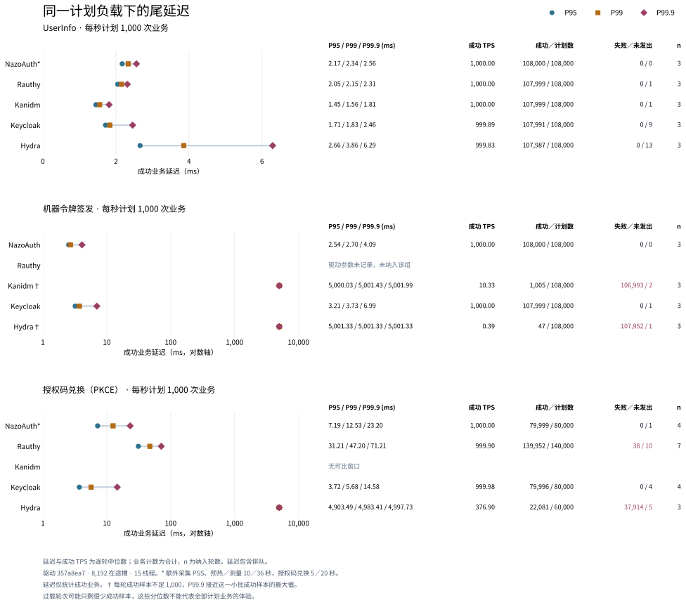
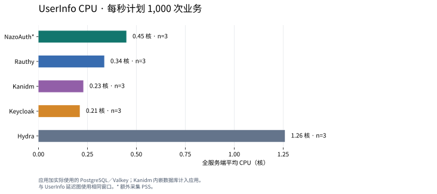
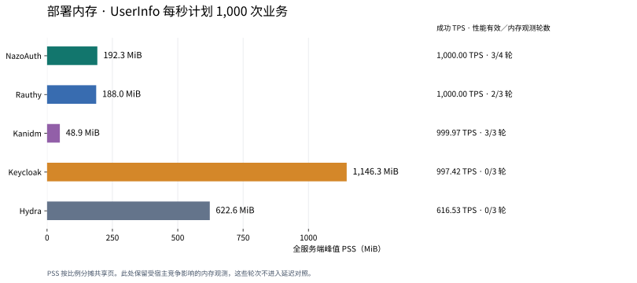

# OAuth / OIDC 单实例性能基准

[English](README.md)

**被测构建：[`33984220`](https://github.com/nazozero/NazoAuth/commit/33984220ed1f48228e4b0f4ed8c345c2f63feb3b)＋[令牌入口开关补丁](fixture/token-ip-quota.patch)。PR #310 的后续代码修订尚未进行五服务负载复测。**

主服务使用 **8 个物理核心，每核 1 个逻辑 CPU**。PostgreSQL、Valkey 和发压端使用独立核心。每次只运行一个 OAuth 服务，以 Goose 0.19.2 的固定到达率测量真实协议请求。

**P95、P99、P99.9 表示成功业务的完成延迟，包含从计划到达开始的排队时间。** 授权和兑换的多次 HTTP 请求合算一笔业务。图表比较同一计划负载下的这三个分位数，并同时显示成功、失败和未发出业务数。实际 TPS 作为负载背景；这些测量没有确定最大可持续吞吐。`n` 是纳入轮数。

[延迟概览](#延迟概览) · [部署内存](#部署内存) · [全部结果](#全部结果) · [测试条件](#测试条件) · [复现](#复现)

归档保存 **367 个单链路窗口**，正式对照纳入 **358 个**，9 个因轮换驱动证据冲突单列保留。纳入窗口中，73 个未达到负载或延迟门槛，**614,769 次已发业务失败全部计入**。另保留 166 个内存观测及其测量质量标记。

## 延迟概览



三个场景使用相同的已记录驱动（`357a8ea7`）、8,192 在途槽及 15 线程，同场景的窗口时长相同。`*` 表示 NazoAuth 的 UserInfo 与授权码兑换额外采集 PSS。机器签发和兑换图使用对数毫秒轴。Rauthy 该档机器签发的唯一轮次未记录驱动参数；Kanidm 没有可比兑换窗口，所以不补入这组对照。其他档位和驱动组见完整结果；含 NazoAuth 的刷新轮换没有跨服务共同驱动组。

**延迟只统计成功完成的业务。** 过载轮次可能只剩很少成功样本：机器签发中，Kanidm 仅成功 **1,005 / 108,000** 次计划业务，Hydra 仅 **47 / 108,000** 次。各轮成功样本均不足 1,000，P99.9 接近这一小批成功样本的最大值，不能代表全部计划业务的体验。图中同时显示成功／计划数及失败／未发出合计。

NazoAuth 的 UserInfo 12,000 TPS 有九个内存观测，均未通过性能有效性核查：**该档没有有效性能测量**。NazoAuth 机器签发 3,000 TPS、Rauthy 机器签发 1,000 TPS 各只有一轮有效测量，保留在完整结果中。

### UserInfo CPU



## 部署内存



PSS 按共享比例分摊进程内存。PostgreSQL 共享页会在多个进程的 RSS 中重复计数，所以 RSS 合计不等于实际物理内存。图中内存观测包括宿主干扰轮，右侧同时显示实际成功 TPS 和性能有效轮数；无效轮不进入延迟对照。不同服务沿用各自业务数据。[原始内存观测](evidence/protocol-memory.jsonl) · [Linux 内存计量](https://docs.kernel.org/filesystems/proc.html)

<details>
<summary>五服务场景覆盖</summary>

| 业务／已测目标 TPS | NazoAuth | Rauthy | Kanidm | Keycloak | Hydra |
|---|---|---|---|---|---|
| 机器令牌签发 | 100、1,000、3,000、6,000 | 12、100、1,000、3,000、6,000 | 12、100、1,000 | 12、100、1,000、2,000、3,000 | 12、100、550、1,000 |
| 机器令牌内省 | 100、1,000、3,000、6,000 | 100、1,000、3,000、6,000、9,000、12,000 | 100、1,000、3,000、6,000、12,000 | 100、1,000、3,000、12,000 | 100、1,000、3,000、6,000 |
| 用户令牌内省 | 1,000 | 1,000 | 1,000 | 1,000 | 1,000 |
| 用户资料 | 100、1,000、3,000、6,000 | 100、1,000、3,000、6,000、12,000 | 100、1,000、3,000、6,000、12,000 | 100、1,000、3,000、6,000、12,000 | 100、1,000、3,000、6,000、12,000 |
| 授权码兑换（PKCE） | 100、1,000、3,000 | 100、1,000、3,000 | — | 100、1,000、3,000 | 100、1,000 |
| 刷新令牌轮换 | 1,000、3,000 | — | — | 100、1,000、3,000 | 100、1,000 |
| 已登录静默授权＋兑换 | 100、1,000 | 100、1,000 | 100、1,000 | 100 | — |
| 已登录授权＋兑换（显式同意） | 100、1,000 | — | — | 100 | — |

— 表示没有该共同语义下的有效测量；各档轮数见完整结果。

</details>

## 全部结果

同一行按产品构建、场景、令牌族规模、已记录的驱动二进制与参数、采样方式分组。未知驱动参数单独列组。分位延迟、吞吐、CPU、内存各取逐轮中位数，Max 取全部轮次最大值；**失败与未发出为所列轮次合计**。最后一列为总轮数／有成功延迟的轮数／有原始账本的轮数。驱动栏为二进制 SHA-256 前八位、在途槽和线程数；未记录的字段以 `?` 标明，单轮结果单列。

<details>
<summary>机器令牌签发</summary>

| 目标 TPS | 服务 | 采样 | 驱动／槽／线程 | 发出／成功 TPS | 失败／未发出合计 | P50 / P95 / P99 / P99.9 / Max ms | CPU 主／总（核） | RSS 主／总 MiB | PSS 主／总 MiB | 宿主 PSI 范围 % | 轮数／延迟／账本 |
|---|---|---|---|---|---|---|---|---|---|---|---|
| 12 | Rauthy | 标准 | be0010eb / 8192 / 15 | 12.00 / 12.00 | 0 / 0 | 3.96 / 5.09 / 7.82 / 12.25 / 55.65 | 0.02 / 0.03 | 80.3 / 499.6 | — | 0.05–10.26 | 3 / 3 / 0 |
| 12 | Kanidm | 标准 | ? / ? / ? | 12.00 / 12.00 | 0 / 0 | 11.12 / 24.60 / 65.84 / 173.28 / 312.13 | 0.08 / 0.08 | 66.8 / 66.8 | — | 0.06–0.27 | 2 / 2 / 0 |
| 12 | Kanidm | 标准 | be0010eb / 8192 / 15 | 12.00 / 12.00 | 0 / 0 | 11.09 / 24.65 / 49.12 / 220.33 / 220.33 | 0.09 / 0.09 | 114.9 / 114.9 | — | 6.55–6.55 | 1 / 1 / 0（单轮） |
| 12 | Keycloak | 标准 | be0010eb / 8192 / 15 | 12.00 / 12.00 | 0 / 0 | 6.66 / 8.35 / 9.60 / 33.68 / 56.35 | 0.13 / 0.13 | 816.1 / 1,041.0 | — | 0.19–11.36 | 3 / 3 / 0 |
| 12 | Hydra | 标准 | be0010eb / 8192 / 15 | 12.00 / 12.00 | 0 / 0 | 9.15 / 10.86 / 13.94 / 16.11 / 32.01 | 0.09 / 0.10 | 51.8 / 261.0 | — | 0.10–0.45 | 3 / 3 / 0 |
| 100 | NazoAuth | 标准 | 357a8ea7 / 8192 / 15 | 100.00 / 100.00 | 0 / 0 | 1.38 / 2.10 / 2.23 / 2.63 / 5.29 | 0.04 / 0.08 | 21.7 / 560.0 | — | 0.14–0.23 | 3 / 3 / 3 |
| 100 | Rauthy | 标准 | ? / ? / ? | 100.00 / 100.00 | 0 / 0 | 3.53 / 5.74 / 8.26 / 12.69 / 13.73 | 0.17 / 0.19 | 82.2 / 691.3 | — | 0.09–0.09 | 1 / 1 / 0（单轮） |
| 100 | Rauthy | 标准 | be0010eb / 8192 / 15 | 100.00 / 100.00 | 0 / 0 | 3.21 / 5.46 / 8.81 / 15.36 / 22.64 | 0.16 / 0.18 | 81.5 / 527.5 | — | 0.31–2.00 | 2 / 2 / 0 |
| 100 | Kanidm | 标准 | be0010eb / 8192 / 15 | 100.00 / 18.81 | 15,522 / 1 | 3,444.72 / 4,998.66 / 5,000.82 / 5,001.78 / 5,002.37 | 0.62 / 0.62 | 328.1 / 328.1 | — | 0.04–10.15 | 6 / 3 / 0 |
| 100 | Keycloak | 标准 | be0010eb / 8192 / 15 | 100.00 / 100.00 | 0 / 0 | 2.80 / 3.82 / 4.40 / 7.19 / 14.31 | 0.40 / 0.41 | 886.4 / 1,100.4 | — | 0.14–0.69 | 3 / 3 / 0 |
| 100 | Hydra | 标准 | ? / ? / ? | 100.00 / 100.00 | 0 / 0 | 8.78 / 12.04 / 16.60 / 43.73 / 72.60 | 0.71 / 0.75 | 58.0 / 1,208.3 | — | 0.21–0.21 | 1 / 1 / 0（单轮） |
| 100 | Hydra | 标准 | be0010eb / 8192 / 15 | 100.00 / 100.00 | 0 / 0 | 7.88 / 9.61 / 13.05 / 17.58 / 26.38 | 0.68 / 0.71 | 56.6 / 384.3 | — | 0.25–1.24 | 2 / 2 / 0 |
| 550 | Hydra | 标准 | ? / ? / ? | 549.97 / 422.25 | 4,598 / 1 | 8.43 / 12.87 / 18.08 / 68.17 / 5,001.50 | 3.28 / 3.41 | 314.4 / 2,496.0 | — | 0.31–0.31 | 1 / 1 / 0（单轮） |
| 1,000 | NazoAuth | 标准 | 357a8ea7 / 8192 / 15 | 1,000.00 / 1,000.00 | 0 / 0 | 1.60 / 2.54 / 2.70 / 4.09 / 13.66 | 0.41 / 0.57 | 23.2 / 737.7 | — | 0.13–0.31 | 3 / 3 / 3 |
| 1,000 | Rauthy | 标准 | ? / ? / ? | 1,000.00 / 1,000.00 | 0 / 0 | 4.97 / 13.25 / 21.82 / 42.28 / 60.66 | 1.55 / 1.69 | 85.5 / 1,876.1 | — | 0.22–0.22 | 1 / 1 / 0（单轮） |
| 1,000 | Kanidm | 标准 | 357a8ea7 / 8192 / 15 | 999.97 / 10.33 | 106,993 / 2 | 4,817.54 / 5,000.03 / 5,001.43 / 5,001.99 / 5,002.09 | 0.75 / 0.75 | 568.5 / 568.5 | — | 0.53–1.10 | 3 / 3 / 3 |
| 1,000 | Keycloak | 标准 | 357a8ea7 / 8192 / 15 | 1,000.00 / 1,000.00 | 0 / 1 | 2.27 / 3.21 / 3.73 / 6.99 / 35.90 | 1.44 / 1.48 | 1,030.4 / 1,930.1 | — | 0.36–0.76 | 3 / 3 / 3 |
| 1,000 | Hydra | 标准 | 357a8ea7 / 8192 / 15 | 1,000.00 / 0.39 | 107,952 / 1 | 18.70 / 5,001.33 / 5,001.33 / 5,001.33 / 5,001.79 | 5.63 / 5.74 | 730.8 / 1,489.5 | — | 1.50–2.95 | 3 / 3 / 3 |
| 2,000 | Keycloak | 标准 | ? / ? / ? | 1,999.94 / 1,999.94 | 0 / 2 | 2.02 / 2.68 / 3.22 / 7.48 / 22.21 | 2.69 / 2.80 | 1,010.5 / 2,962.6 | — | 0.19–0.19 | 1 / 1 / 0（单轮） |
| 3,000 | NazoAuth | 标准 | ee4a059e / 8192 / 15 | 2,999.89 / 2,999.89 | 0 / 4 | 1.95 / 3.71 / 4.99 / 7.88 / 80.31 | 1.40 / 1.84 | 33.9 / 2,747.6 | — | 0.86–0.86 | 1 / 1 / 1（单轮） |
| 3,000 | Rauthy | 标准 | ? / ? / ? | 2,375.72 / 2,375.72 | 0 / 22,474 | 3,665.88 / 3,897.74 / 3,963.20 / 3,991.95 / 4,059.62 | 3.15 / 3.34 | 390.9 / 2,100.7 | — | 0.14–0.14 | 1 / 1 / 0（单轮） |
| 3,000 | Keycloak | 标准 | ? / ? / ? | 2,999.90 / 2,999.90 | 0 / 7 | 2.29 / 991.18 / 1,195.63 / 1,240.82 / 1,902.57 | 5.04 / 5.22 | 1,752.2 / 3,102.5 | — | 6.66–9.78 | 2 / 2 / 0 |
| 6,000 | NazoAuth | 标准 | ee4a059e / 8192 / 15 | 6,000.00 / 6,000.00 | 0 / 6 | 1.80 / 3.41 / 4.10 / 6.83 / 15.92 | 2.32 / 3.24 | 33.5 / 2,703.5 | — | 1.08–1.70 | 3 / 3 / 3 |
| 6,000 | Rauthy | 标准 | ee4a059e / 8192 / 15 | 2,048.03 / 2,048.03 | 0 / 428,002 | 4,016.70 / 4,186.62 / 4,227.17 / 4,252.46 / 4,312.47 | 2.74 / 2.98 | 380.5 / 2,193.2 | — | 0.76–2.16 | 3 / 3 / 3 |

</details>

<details>
<summary>机器令牌内省</summary>

| 目标 TPS | 服务 | 采样 | 驱动／槽／线程 | 发出／成功 TPS | 失败／未发出合计 | P50 / P95 / P99 / P99.9 / Max ms | CPU 主／总（核） | RSS 主／总 MiB | PSS 主／总 MiB | 宿主 PSI 范围 % | 轮数／延迟／账本 |
|---|---|---|---|---|---|---|---|---|---|---|---|
| 100 | NazoAuth | 标准 + PSS | 357a8ea7 / 8192 / 15 | 100.00 / 100.00 | 0 / 0 | 1.34 / 2.06 / 2.26 / 2.70 / 6.71 | 0.04 / 0.08 | 27.3 / 478.1 | 25.9 / 330.6 | 0.60–0.80 | 2 / 2 / 2 |
| 100 | Rauthy | 标准 | ? / ? / ? | 100.00 / 100.00 | 0 / 0 | 1.08 / 1.83 / 2.00 / 2.43 / 3.04 | 0.04 / 0.05 | 82.2 / 706.9 | — | 0.16–0.16 | 1 / 1 / 0（单轮） |
| 100 | Rauthy | 标准 | be0010eb / 8192 / 15 | 100.00 / 100.00 | 0 / 0 | 1.33 / 2.09 / 2.25 / 2.73 / 4.01 | 0.04 / 0.05 | 80.9 / 499.3 | — | 0.43–1.13 | 2 / 2 / 0 |
| 100 | Kanidm | 标准 | ? / ? / ? | 100.00 / 100.00 | 0 / 0 | 1.15 / 2.02 / 2.17 / 2.45 / 2.72 | 0.01 / 0.01 | 50.9 / 50.9 | — | 0.06–0.06 | 1 / 1 / 0（单轮） |
| 100 | Kanidm | 标准 | be0010eb / 8192 / 15 | 99.97 / 99.97 | 0 / 2 | 0.86 / 1.50 / 1.63 / 1.90 / 4.11 | 0.01 / 0.01 | 82.3 / 82.3 | — | 0.05–2.92 | 2 / 2 / 0 |
| 100 | Keycloak | 标准 | be0010eb / 8192 / 15 | 100.00 / 100.00 | 0 / 0 | 2.01 / 3.03 / 3.55 / 5.12 / 11.45 | 0.26 / 0.27 | 893.0 / 1,119.3 | — | 0.13–0.96 | 3 / 3 / 0 |
| 100 | Hydra | 标准 | ? / ? / ? | 100.00 / 100.00 | 0 / 0 | 1.93 / 2.71 / 3.11 / 3.88 / 4.87 | 0.13 / 0.15 | 56.0 / 1,049.2 | — | 0.21–0.21 | 1 / 1 / 0（单轮） |
| 100 | Hydra | 标准 | be0010eb / 8192 / 15 | 100.00 / 100.00 | 0 / 0 | 1.89 / 2.65 / 3.07 / 3.79 / 5.85 | 0.13 / 0.15 | 56.0 / 260.5 | — | 0.04–1.73 | 2 / 2 / 0 |
| 1,000 | NazoAuth | 标准 + PSS | 357a8ea7 / 8192 / 15 | 1,000.00 / 1,000.00 | 0 / 1 | 1.20 / 1.80 / 1.95 / 2.74 / 60.56 | 0.27 / 0.45 | 31.9 / 682.1 | 30.3 / 365.8 | 0.30–1.03 | 3 / 3 / 3 |
| 1,000 | Rauthy | 标准 | ? / ? / ? | 1,000.00 / 1,000.00 | 0 / 0 | 1.18 / 1.85 / 2.02 / 2.45 / 5.15 | 0.35 / 0.41 | 79.8 / 638.7 | — | 13.36–13.36 | 1 / 1 / 0（单轮） |
| 1,000 | Rauthy | 标准 | ? / 8192 / ? | 1,000.00 / 1,000.00 | 0 / 0 | 1.27 / 2.10 / 2.26 / 3.73 / 8.98 | 0.32 / 0.38 | 77.3 / 463.0 | — | 1.13–1.13 | 1 / 1 / 0（单轮） |
| 1,000 | Rauthy | 标准 | be0010eb / 8192 / 15 | 999.97 / 999.97 | 0 / 1 | 1.27 / 2.05 / 2.16 / 2.37 / 5.70 | 0.33 / 0.36 | 80.1 / 503.7 | — | 0.24–0.24 | 1 / 1 / 0（单轮） |
| 1,000 | Kanidm | 标准 | ? / ? / ? | 999.97 / 999.97 | 0 / 2 | 0.93 / 1.64 / 1.76 / 1.97 / 4.96 | 0.09 / 0.09 | 51.0 / 51.0 | — | 0.07–2.84 | 2 / 2 / 0 |
| 1,000 | Kanidm | 标准 | be0010eb / 8192 / 15 | 999.28 / 999.28 | 0 / 26 | 1.20 / 2.11 / 2.24 / 3.88 / 19.48 | 0.09 / 0.09 | 77.0 / 77.0 | — | 8.47–8.47 | 1 / 1 / 0（单轮） |
| 1,000 | Keycloak | 标准 | be0010eb / 8192 / 15 | 1,000.00 / 1,000.00 | 0 / 0 | 1.18 / 1.73 / 1.94 / 5.66 / 19.19 | 0.45 / 0.49 | 1,000.7 / 1,360.2 | — | 0.07–0.58 | 3 / 3 / 0 |
| 1,000 | Hydra | 标准 | ? / ? / ? | 1,000.00 / 1,000.00 | 0 / 0 | 1.30 / 2.31 / 2.74 / 3.81 / 23.33 | 1.11 / 1.21 | 57.1 / 1,184.8 | — | 0.08–0.08 | 1 / 1 / 0（单轮） |
| 1,000 | Hydra | 标准 | be0010eb / 8192 / 15 | 1,000.00 / 1,000.00 | 0 / 0 | 1.38 / 2.41 / 2.87 / 3.80 / 15.06 | 1.10 / 1.20 | 57.4 / 392.9 | — | 0.16–0.19 | 2 / 2 / 0 |
| 3,000 | NazoAuth | 标准 + PSS | 357a8ea7 / 8192 / 15 | 3,000.00 / 3,000.00 | 0 / 4 | 1.43 / 2.72 / 3.02 / 3.97 / 20.85 | 0.69 / 1.40 | 33.3 / 1,090.5 | 31.8 / 385.2 | 0.29–0.41 | 3 / 3 / 3 |
| 3,000 | Rauthy | 标准 | ? / ? / ? | 2,999.86 / 2,999.86 | 0 / 5 | 1.64 / 2.68 / 3.03 / 4.04 / 7.41 | 0.85 / 0.93 | 81.7 / 516.9 | — | 0.07–0.07 | 1 / 1 / 0（单轮） |
| 3,000 | Rauthy | 标准 | be0010eb / 8192 / 15 | 2,999.90 / 2,999.90 | 0 / 7 | 1.18 / 2.19 / 2.54 / 2.91 / 7.12 | 0.78 / 0.86 | 82.1 / 514.4 | — | 0.29–0.30 | 2 / 2 / 0 |
| 3,000 | Kanidm | 标准 | be0010eb / 8192 / 15 | 2,999.94 / 2,999.94 | 0 / 88 | 0.99 / 2.17 / 2.40 / 2.53 / 5.67 | 0.30 / 0.30 | 94.8 / 94.8 | — | 3.56–17.84 | 3 / 3 / 0 |
| 3,000 | Keycloak | 标准 | ? / ? / ? | 2,999.94 / 2,999.94 | 0 / 4 | 1.13 / 2.01 / 2.35 / 8.90 / 30.54 | 1.34 / 1.47 | 1,012.2 / 2,249.1 | — | 0.18–0.24 | 2 / 2 / 0 |
| 3,000 | Keycloak | 标准 | be0010eb / 8192 / 15 | 2,999.97 / 2,999.97 | 0 / 1 | 1.54 / 2.78 / 3.20 / 9.27 / 28.18 | 1.44 / 1.61 | 1,013.8 / 2,025.5 | — | 0.31–0.31 | 1 / 1 / 0（单轮） |
| 3,000 | Hydra | 标准 | be0010eb / 8192 / 15 | 2,999.89 / 2,999.89 | 0 / 11 | 3.28 / 67.70 / 82.74 / 90.28 / 231.75 | 2.74 / 3.09 | 90.7 / 3,275.6 | — | 0.59–3.44 | 3 / 3 / 0 |
| 6,000 | NazoAuth | 标准 + PSS | ee4a059e / 8192 / 15 | 5,999.94 / 5,999.94 | 0 / 6 | 1.26 / 2.17 / 2.49 / 4.25 / 16.19 | 1.12 / 2.94 | 35.1 / 2,110.8 | 33.6 / 1,215.9 | 0.53–1.74 | 3 / 3 / 3 |
| 6,000 | Rauthy | 标准 | ee4a059e / 8192 / 15 | 5,999.89 / 5,999.89 | 0 / 4 | 1.57 / 2.70 / 3.08 / 5.69 / 10.46 | 1.58 / 1.85 | 85.3 / 974.6 | — | 8.09–8.09 | 1 / 1 / 1（单轮） |
| 6,000 | Kanidm | 标准 | ee4a059e / 8192 / 15 | 5,999.92 / 5,999.92 | 0 / 16 | 0.88 / 1.95 / 2.27 / 2.37 / 5.22 | 0.48 / 0.48 | 58.3 / 58.3 | — | 0.52–6.09 | 3 / 3 / 3 |
| 6,000 | Hydra | 标准 + PSS | 54e36521 / 8192 / 15 | 3,267.62 / 3,261.24 | 460 / 196,731 | 2,508.99 / 2,632.79 / 2,733.24 / 4,906.14 / 5,001.55 | 3.09 / 3.45 | 858.0 / 4,447.3 | 858.0 / 2,021.5 | 2.95–4.96 | 2 / 2 / 2 |
| 9,000 | Rauthy | 标准 | ? / ? / ? | 8,999.78 / 8,999.78 | 0 / 8 | 1.65 / 3.00 / 3.78 / 6.18 / 20.32 | 2.37 / 2.64 | 85.0 / 1,382.1 | — | 0.10–0.10 | 1 / 1 / 0（单轮） |
| 12,000 | Rauthy | 标准 | ? / ? / ? | 11,999.47 / 11,999.47 | 0 / 19 | 1.69 / 3.37 / 4.55 / 7.81 / 16.61 | 3.23 / 3.59 | 88.0 / 1,627.9 | — | 0.33–0.33 | 1 / 1 / 0（单轮） |
| 12,000 | Rauthy | 标准 | ? / 8192 / ? | 11,999.58 / 11,999.58 | 0 / 15 | 1.71 / 3.32 / 4.20 / 5.76 / 16.83 | 3.06 / 3.38 | 87.3 / 1,285.7 | — | 0.68–0.68 | 1 / 1 / 0（单轮） |
| 12,000 | Kanidm | 标准 | ee4a059e / 8192 / 15 | 11,999.94 / 11,999.94 | 0 / 17 | 0.85 / 1.40 / 1.52 / 2.01 / 5.17 | 0.88 / 0.88 | 59.0 / 59.0 | — | 0.62–1.25 | 3 / 3 / 3 |
| 12,000 | Keycloak | 标准 | ? / ? / ? | 10,823.03 / 10,823.03 | 0 / 152,770 | 4.63 / 1,158.07 / 1,285.91 / 1,337.63 / 1,482.77 | 6.76 / 7.41 | 3,730.1 / 5,485.1 | — | 10.70–17.20 | 3 / 3 / 0 |
| 12,000 | Keycloak | 标准 | ? / 8192 / ? | 11,177.67 / 11,177.67 | 0 / 29,604 | 2.13 / 1,031.58 / 1,130.66 / 1,183.00 / 1,221.82 | 6.42 / 7.01 | 3,951.6 / 4,863.8 | — | 29.04–29.04 | 1 / 1 / 0（单轮） |
| 12,000 | Rauthy | 宽 | ab3fc072 / 32768 / 24 | 11,996.06 / 11,996.06 | 0 / 351 | 1.80 / 3.59 / 4.76 / 10.04 / 73.13 | 3.19 / 3.71 | 96.5 / 1,416.1 | — | 0.65–8.57 | 3 / 3 / 0 |
| 12,000 | Keycloak | 宽 | ab3fc072 / 32768 / 24 | 10,205.67 / 10,205.67 | 2 / 192,014 | 2,297.65 / 4,392.94 / 4,790.36 / 4,876.01 / 4,979.88 | 7.79 / 8.49 | 4,836.9 / 5,646.9 | — | 18.57–21.58 | 3 / 3 / 0 |

</details>

<details>
<summary>用户令牌内省</summary>

| 目标 TPS | 服务 | 采样 | 驱动／槽／线程 | 发出／成功 TPS | 失败／未发出合计 | P50 / P95 / P99 / P99.9 / Max ms | CPU 主／总（核） | RSS 主／总 MiB | PSS 主／总 MiB | 宿主 PSI 范围 % | 轮数／延迟／账本 |
|---|---|---|---|---|---|---|---|---|---|---|---|
| 1,000 | NazoAuth | 标准 + PSS | 357a8ea7 / 8192 / 15 | 999.97 / 999.97 | 0 / 2 | 1.32 / 1.98 / 2.14 / 2.84 / 6.93 | 0.20 / 0.58 | 32.8 / 997.2 | 31.3 / 383.5 | 0.19–0.59 | 3 / 3 / 3 |
| 1,000 | Rauthy | 标准 | ee4a059e / 8192 / 15 | 999.97 / 999.97 | 0 / 3 | 1.19 / 1.94 / 2.08 / 3.15 / 8.47 | 0.30 / 0.34 | 82.3 / 848.6 | — | 0.14–35.63 | 5 / 5 / 5 |
| 1,000 | Kanidm | 标准 | ee4a059e / 8192 / 15 | 999.97 / 999.97 | 0 / 4 | 1.11 / 1.83 / 2.17 / 3.46 / 7.44 | 0.25 / 0.25 | 52.8 / 52.8 | — | 7.84–13.84 | 3 / 3 / 3 |
| 1,000 | Keycloak | 标准 | 54e36521 / 8192 / 15 | 1,000.00 / 1,000.00 | 0 / 1 | 1.27 / 2.07 / 2.55 / 11.41 / 28.79 | 0.49 / 0.49 | 1,047.5 / 2,680.1 | — | 0.33–24.22 | 3 / 3 / 3 |
| 1,000 | Hydra | 标准 | 357a8ea7 / 8192 / 15 | 999.99 / 999.99 | 0 / 1 | 1.83 / 2.90 / 3.53 / 5.68 / 17.79 | 1.26 / 1.35 | 61.8 / 2,686.1 | — | 0.66–1.64 | 2 / 2 / 2 |
| 1,000 | Hydra | 标准 | 54e36521 / 8192 / 15 | 999.97 / 999.97 | 0 / 2 | 1.94 / 3.08 / 3.74 / 5.13 / 16.13 | 1.30 / 1.40 | 59.7 / 2,259.4 | — | 0.44–1.19 | 3 / 3 / 3 |

</details>

<details>
<summary>用户资料</summary>

| 目标 TPS | 服务 | 采样 | 驱动／槽／线程 | 发出／成功 TPS | 失败／未发出合计 | P50 / P95 / P99 / P99.9 / Max ms | CPU 主／总（核） | RSS 主／总 MiB | PSS 主／总 MiB | 宿主 PSI 范围 % | 轮数／延迟／账本 |
|---|---|---|---|---|---|---|---|---|---|---|---|
| 100 | NazoAuth | 标准 + PSS | 357a8ea7 / 8192 / 15 | 100.00 / 100.00 | 0 / 0 | 1.59 / 2.25 / 2.44 / 2.80 / 11.29 | 0.03 / 0.09 | 31.8 / 640.7 | 30.4 / 192.5 | 0.16–1.45 | 4 / 4 / 4 |
| 100 | Rauthy | 标准 | 357a8ea7 / 8192 / 15 | 100.00 / 100.00 | 0 / 0 | 1.40 / 2.04 / 2.20 / 2.43 / 3.38 | 0.04 / 0.05 | 81.6 / 502.3 | — | 0.24–0.29 | 3 / 3 / 0 |
| 100 | Kanidm | 标准 | 357a8ea7 / 8192 / 15 | 100.00 / 100.00 | 0 / 1 | 1.11 / 1.56 / 1.71 / 1.98 / 5.33 | 0.03 / 0.03 | 84.5 / 84.5 | — | 0.04–6.55 | 3 / 3 / 0 |
| 100 | Keycloak | 标准 | 357a8ea7 / 8192 / 15 | 100.00 / 100.00 | 0 / 2 | 1.42 / 2.20 / 2.76 / 4.37 / 12.40 | 0.17 / 0.17 | 1,034.6 / 1,616.5 | — | 0.08–4.73 | 3 / 3 / 0 |
| 100 | Hydra | 标准 | 357a8ea7 / 8192 / 15 | 100.00 / 100.00 | 0 / 1 | 2.13 / 3.13 / 3.52 / 4.45 / 5.86 | 0.14 / 0.15 | 58.5 / 758.7 | — | 0.13–5.55 | 3 / 3 / 0 |
| 1,000 | NazoAuth | 标准 + PSS | 357a8ea7 / 8192 / 15 | 1,000.00 / 1,000.00 | 0 / 0 | 1.37 / 2.17 / 2.34 / 2.56 / 6.18 | 0.11 / 0.45 | 32.0 / 656.0 | 30.5 / 193.7 | 0.24–2.15 | 3 / 3 / 3 |
| 1,000 | Rauthy | 标准 | 357a8ea7 / 8192 / 15 | 1,000.00 / 1,000.00 | 0 / 1 | 1.24 / 2.05 / 2.15 / 2.31 / 5.56 | 0.30 / 0.34 | 82.4 / 505.2 | — | 0.19–0.32 | 3 / 3 / 0 |
| 1,000 | Kanidm | 标准 | 357a8ea7 / 8192 / 15 | 1,000.00 / 1,000.00 | 0 / 1 | 0.91 / 1.45 / 1.56 / 1.81 / 6.27 | 0.23 / 0.23 | 90.6 / 90.6 | — | 0.08–5.08 | 3 / 3 / 0 |
| 1,000 | Keycloak | 标准 | 357a8ea7 / 8192 / 15 | 999.89 / 999.89 | 0 / 9 | 1.04 / 1.71 / 1.83 / 2.46 / 5.76 | 0.21 / 0.21 | 1,018.9 / 1,662.1 | — | 0.05–5.50 | 3 / 3 / 0 |
| 1,000 | Hydra | 标准 | 357a8ea7 / 8192 / 15 | 999.83 / 999.83 | 0 / 13 | 1.60 / 2.66 / 3.86 / 6.29 / 10.88 | 1.15 / 1.26 | 59.7 / 743.5 | — | 0.23–11.55 | 3 / 3 / 0 |
| 3,000 | NazoAuth | 标准 + PSS | 357a8ea7 / 8192 / 15 | 2,999.94 / 2,999.94 | 0 / 12 | 1.13 / 1.91 / 2.11 / 2.88 / 28.90 | 0.35 / 1.29 | 32.9 / 666.1 | 31.5 / 195.3 | 0.23–1.07 | 6 / 6 / 6 |
| 3,000 | Rauthy | 标准 | ? / ? / ? | 2,999.89 / 2,999.89 | 0 / 11 | 1.60 / 2.72 / 3.18 / 3.33 / 7.78 | 0.94 / 1.03 | 83.1 / 511.9 | — | 1.02–2.14 | 3 / 3 / 0 |
| 3,000 | Kanidm | 标准 | ? / ? / ? | 2,999.94 / 2,999.94 | 0 / 7 | 1.02 / 1.67 / 1.83 / 2.12 / 4.96 | 0.77 / 0.77 | 65.5 / 65.5 | — | 1.28–1.77 | 3 / 3 / 0 |
| 3,000 | Keycloak | 标准 | ? / ? / ? | 2,999.89 / 2,999.89 | 0 / 11 | 1.12 / 2.33 / 2.54 / 3.09 / 17.36 | 0.69 / 0.69 | 1,067.0 / 1,718.7 | — | 1.33–1.59 | 3 / 3 / 0 |
| 3,000 | Hydra | 标准 | ? / ? / ? | 2,999.97 / 2,999.97 | 0 / 7 | 3.87 / 9.25 / 14.14 / 19.85 / 595.51 | 2.98 / 3.29 | 67.0 / 706.8 | — | 0.84–11.21 | 3 / 3 / 0 |
| 6,000 | NazoAuth | 标准 + PSS | 357a8ea7 / 8192 / 15 | 5,999.94 / 5,999.94 | 0 / 11 | 1.25 / 2.15 / 2.41 / 3.54 / 17.35 | 0.61 / 2.86 | 34.3 / 991.0 | 32.8 / 233.1 | 0.32–1.81 | 5 / 5 / 5 |
| 6,000 | Rauthy | 标准 | ? / ? / ? | 5,999.69 / 5,999.69 | 0 / 55 | 1.59 / 2.80 / 3.20 / 4.25 / 13.32 | 1.73 / 1.91 | 83.4 / 808.4 | — | 0.30–0.67 | 3 / 3 / 0 |
| 6,000 | Kanidm | 标准 | ? / ? / ? | 5,999.92 / 5,999.92 | 0 / 13 | 1.13 / 1.96 / 2.21 / 2.69 / 6.11 | 1.54 / 1.54 | 63.7 / 63.7 | — | 0.15–1.39 | 3 / 3 / 0 |
| 6,000 | Keycloak | 标准 | ? / ? / ? | 5,999.83 / 5,999.83 | 0 / 28 | 1.05 / 1.73 / 2.00 / 7.15 / 27.02 | 1.24 / 1.24 | 1,230.4 / 1,953.9 | — | 0.71–1.78 | 3 / 3 / 0 |
| 6,000 | Hydra | 标准 | ? / ? / ? | 3,286.06 / 3,280.19 | 998 / 294,722 | 2,499.90 / 2,560.83 / 2,580.25 / 4,983.09 / 5,002.61 | 3.34 / 3.68 | 860.1 / 1,955.4 | — | 0.56–2.22 | 3 / 3 / 0 |
| 12,000 | Rauthy | 标准 | ? / ? / ? | 11,999.75 / 11,999.75 | 0 / 31 | 1.92 / 4.03 / 5.78 / 10.52 / 41.02 | 3.22 / 3.54 | 88.3 / 1,095.2 | — | 0.15–0.43 | 3 / 3 / 0 |
| 12,000 | Kanidm | 标准 | ? / ? / ? | 11,999.47 / 11,999.47 | 0 / 94 | 1.43 / 2.59 / 3.09 / 5.20 / 20.38 | 3.59 / 3.59 | 60.0 / 60.0 | — | 0.20–0.42 | 3 / 3 / 0 |
| 12,000 | Keycloak | 标准 | ? / ? / ? | 11,999.53 / 11,999.53 | 0 / 44 | 1.57 / 2.90 / 12.92 / 102.24 / 222.04 | 2.97 / 2.97 | 2,840.5 / 3,563.4 | — | 2.76–3.79 | 3 / 3 / 0 |
| 12,000 | Hydra | 标准 | ? / ? / ? | 3,158.39 / 3,144.94 | 1,433 / 956,500 | 2,606.90 / 2,664.22 / 2,696.44 / 2,703.40 / 4,994.90 | 3.35 / 3.67 | 870.2 / 1,944.3 | — | 0.39–0.82 | 3 / 3 / 0 |

</details>

<details>
<summary>授权码兑换（PKCE）</summary>

| 目标 TPS | 服务 | 采样 | 驱动／槽／线程 | 发出／成功 TPS | 失败／未发出合计 | P50 / P95 / P99 / P99.9 / Max ms | CPU 主／总（核） | RSS 主／总 MiB | PSS 主／总 MiB | 宿主 PSI 范围 % | 轮数／延迟／账本 |
|---|---|---|---|---|---|---|---|---|---|---|---|
| 100 | NazoAuth | 标准 + PSS | 357a8ea7 / 8192 / 15 | 100.00 / 100.00 | 0 / 0 | 3.88 / 6.47 / 10.02 / 18.15 / 21.75 | 0.09 / 0.24 | 32.0 / 1,559.2 | 30.6 / 466.3 | 0.19–0.38 | 3 / 3 / 3 |
| 100 | Rauthy | 标准 | 357a8ea7 / 8192 / 15 | 100.00 / 100.00 | 0 / 0 | 7.37 / 11.87 / 19.92 / 36.35 / 57.48 | 0.32 / 0.37 | 88.6 / 580.8 | — | 0.23–0.31 | 3 / 3 / 0 |
| 100 | Keycloak | 标准 | 357a8ea7 / 8192 / 15 | 100.00 / 100.00 | 0 / 0 | 3.81 / 5.45 / 6.22 / 7.38 / 12.23 | 0.50 / 0.51 | 1,105.9 / 1,770.3 | — | 0.03–4.17 | 3 / 3 / 0 |
| 100 | Hydra | 标准 | 357a8ea7 / 8192 / 15 | 100.00 / 100.00 | 0 / 2 | 17.36 / 21.84 / 26.96 / 34.46 / 105.68 | 1.46 / 1.55 | 60.8 / 1,878.8 | — | 0.22–9.15 | 6 / 6 / 0 |
| 1,000 | NazoAuth | 标准 + PSS | 357a8ea7 / 8192 / 15 | 1,000.00 / 1,000.00 | 0 / 1 | 3.66 / 7.19 / 12.53 / 23.20 / 36.45 | 0.90 / 1.84 | 34.9 / 3,942.3 | 33.5 / 596.3 | 0.22–1.32 | 4 / 4 / 4 |
| 1,000 | NazoAuth | 标准 + PSS | ee4a059e / 8192 / 15 | 1,000.00 / 1,000.00 | 0 / 0 | 4.47 / 9.62 / 14.10 / 21.48 / 26.72 | 0.86 / 2.04 | 34.2 / 6,422.1 | 32.7 / 1,288.3 | 0.63–0.63 | 1 / 1 / 1（单轮） |
| 1,000 | Rauthy | 标准 | 357a8ea7 / 8192 / 15 | 999.95 / 999.90 | 38 / 10 | 14.74 / 31.21 / 47.20 / 71.21 / 874.58 | 2.95 / 3.45 | 128.1 / 2,998.5 | — | 0.25–0.76 | 7 / 7 / 1 |
| 1,000 | Rauthy | 标准 + PSS | ee4a059e / 8192 / 15 | 1,000.00 / 1,000.00 | 0 / 0 | 15.67 / 33.57 / 47.34 / 66.81 / 107.50 | 2.92 / 3.51 | 133.8 / 3,720.5 | 129.8 / 373.1 | 0.35–0.46 | 3 / 3 / 3 |
| 1,000 | Keycloak | 标准 | 357a8ea7 / 8192 / 15 | 999.98 / 999.98 | 0 / 4 | 2.61 / 3.72 / 5.68 / 14.58 / 31.37 | 2.34 / 2.35 | 1,164.4 / 4,531.4 | — | 0.46–13.44 | 4 / 4 / 1 |
| 1,000 | Hydra | 标准 | 357a8ea7 / 8192 / 15 | 999.95 / 376.90 | 37,914 / 5 | 4,016.06 / 4,903.49 / 4,983.41 / 4,997.73 / 5,001.71 | 7.98 / 8.40 | 604.0 / 11,318.4 | — | 0.37–4.68 | 3 / 3 / 0 |
| 1,000 | Hydra | 标准 + PSS | 54e36521 / 8192 / 15 | 999.88 / 379.48 | 24,816 / 5 | 3,995.55 / 4,911.52 / 4,983.11 / 4,999.61 / 5,001.70 | 7.90 / 8.38 | 600.8 / 6,753.3 | 600.8 / 1,465.3 | 10.15–10.22 | 2 / 2 / 2 |
| 3,000 | NazoAuth | 标准 + PSS | 357a8ea7 / 8192 / 15 | 2,999.90 / 2,999.90 | 0 / 7 | 4.97 / 15.34 / 32.69 / 46.35 / 99.20 | 2.64 / 5.77 | 42.4 / 7,218.1 | 40.9 / 919.2 | 0.90–1.38 | 3 / 3 / 3 |
| 3,000 | Rauthy | 标准 | ee4a059e / 8192 / 15 | 1,638.00 / 0.00 | 98,285 / 81,715 | — / — / — / — / — | 4.19 / 4.77 | 1,168.5 / 3,846.0 | — | 0.40–1.45 | 3 / 0 / 3 |
| 3,000 | Keycloak | 标准 | ? / ? / ? | 2,994.75 / 2,994.75 | 0 / 1,360 | 2,034.61 / 2,734.94 / 2,768.77 / 2,828.61 / 3,141.53 | 7.80 / 7.82 | 2,526.0 / 4,842.7 | — | 13.70–50.59 | 3 / 3 / 0 |
| 3,000 | Keycloak | 标准 | ? / 8192 / ? | 2,999.90 / 2,999.90 | 0 / 2 | 2,059.63 / 2,611.82 / 2,642.80 / 2,683.55 / 2,730.42 | 7.78 / 7.80 | 2,521.6 / 5,197.8 | — | 48.48–48.48 | 1 / 1 / 0（单轮） |

</details>

<details>
<summary>刷新令牌轮换（32×8）</summary>

| 目标 TPS | 服务 | 采样 | 驱动／槽／线程 | 发出／成功 TPS | 失败／未发出合计 | P50 / P95 / P99 / P99.9 / Max ms | CPU 主／总（核） | RSS 主／总 MiB | PSS 主／总 MiB | 宿主 PSI 范围 % | 轮数／延迟／账本 |
|---|---|---|---|---|---|---|---|---|---|---|---|
| 100 | Keycloak | 标准 | 4da1b185 / 8192 / 15 | 100.00 / 100.00 | 0 / 1 | 4.52 / 6.16 / 7.33 / 10.51 / 22.64 | 0.60 / 0.63 | 1,095.0 / 1,832.3 | — | 0.03–9.36 | 3 / 3 / 0 |
| 100 | Hydra | 标准 | 4da1b185 / 8192 / 15 | 100.00 / 100.00 | 0 / 2 | 15.71 / 20.06 / 22.80 / 52.84 / 115.36 | 1.41 / 1.49 | 61.9 / 1,392.0 | — | 2.44–5.43 | 3 / 3 / 0 |

</details>

<details>
<summary>刷新令牌轮换（64×8）</summary>

| 目标 TPS | 服务 | 采样 | 驱动／槽／线程 | 发出／成功 TPS | 失败／未发出合计 | P50 / P95 / P99 / P99.9 / Max ms | CPU 主／总（核） | RSS 主／总 MiB | PSS 主／总 MiB | 宿主 PSI 范围 % | 轮数／延迟／账本 |
|---|---|---|---|---|---|---|---|---|---|---|---|
| 1,000 | NazoAuth | 标准 + PSS | ee4a059e / 8192 / 15 | 996.61 / 996.61 | 0 / 244 | 4.76 / 50.07 / 229.22 / 309.02 / 636.10 | 0.96 / 2.67 | 47.6 / 9,945.6 | 46.1 / 1,340.5 | 0.42–0.62 | 2 / 2 / 2 |
| 1,000 | Keycloak | 标准 | 4da1b185 / 8192 / 15 | 999.75 / 999.75 | 0 / 25 | 3.49 / 4.66 / 7.97 / 21.52 / 57.99 | 2.87 / 3.07 | 1,158.4 / 4,774.4 | — | 8.77–14.11 | 3 / 3 / 0 |
| 1,000 | Keycloak | 标准 + PSS | 54e36521 / 8192 / 15 | 999.94 / 999.94 | 0 / 4 | 3.56 / 4.48 / 6.32 / 19.41 / 41.46 | 2.62 / 2.78 | 1,151.2 / 2,069.2 | 1,149.2 / 1,288.5 | 0.28–0.32 | 2 / 2 / 2 |
| 1,000 | Hydra | 标准 | 4da1b185 / 8192 / 15 | 585.42 / 585.42 | 0 / 44,928 | 577.04 / 1,163.93 / 1,483.76 / 1,909.82 / 2,626.78 | 7.81 / 8.53 | 113.7 / 14,387.7 | — | 0.74–14.77 | 3 / 3 / 0 |
| 1,000 | Hydra | 标准 + PSS | 54e36521 / 8192 / 15 | 595.58 / 595.58 | 0 / 43,232 | 566.40 / 1,132.03 / 1,443.00 / 1,891.70 / 2,706.18 | 7.91 / 8.66 | 111.6 / 13,287.6 | 111.6 / 759.9 | 8.21–12.88 | 3 / 3 / 3 |

</details>

<details>
<summary>刷新令牌轮换（128×10）</summary>

| 目标 TPS | 服务 | 采样 | 驱动／槽／线程 | 发出／成功 TPS | 失败／未发出合计 | P50 / P95 / P99 / P99.9 / Max ms | CPU 主／总（核） | RSS 主／总 MiB | PSS 主／总 MiB | 宿主 PSI 范围 % | 轮数／延迟／账本 |
|---|---|---|---|---|---|---|---|---|---|---|---|
| 3,000 | NazoAuth | 标准 + PSS | ee4a059e / 8192 / 15 | 2,999.97 / 2,999.97 | 0 / 5 | 5.48 / 11.28 / 22.81 / 54.34 / 109.60 | 2.96 / 8.05 | 42.8 / 14,905.4 | 41.3 / 1,310.9 | 1.46–1.53 | 3 / 3 / 3 |
| 3,000 | Keycloak | 标准 | 4da1b185 / 8192 / 15 | 2,844.11 / 2,844.11 | 0 / 18,474 | 288.70 / 426.58 / 491.20 / 532.70 / 597.44 | 7.95 / 8.77 | 1,406.9 / 7,923.8 | — | 13.33–18.59 | 3 / 3 / 0 |

</details>

<details>
<summary>刷新令牌轮换（32×47）</summary>

| 目标 TPS | 服务 | 采样 | 驱动／槽／线程 | 发出／成功 TPS | 失败／未发出合计 | P50 / P95 / P99 / P99.9 / Max ms | CPU 主／总（核） | RSS 主／总 MiB | PSS 主／总 MiB | 宿主 PSI 范围 % | 轮数／延迟／账本 |
|---|---|---|---|---|---|---|---|---|---|---|---|
| 3,000 | Keycloak | 标准 | ? / ? / ? | 2,734.81 / 2,734.81 | 0 / 24,338 | 337.88 / 522.00 / 579.33 / 626.24 / 736.78 | 7.95 / 8.72 | 1,543.2 / 4,560.8 | — | 14.27–22.36 | 3 / 3 / 0 |
| 3,000 | Keycloak | 标准 | ? / 8192 / ? | 2,925.00 / 2,925.00 | 0 / 5,400 | 180.10 / 409.48 / 517.92 / 545.01 / 625.17 | 7.92 / 8.68 | 1,425.2 / 4,947.3 | — | 42.53–45.35 | 2 / 2 / 0 |

</details>

<details>
<summary>已登录授权＋兑换（显式同意）</summary>

| 目标 TPS | 服务 | 采样 | 驱动／槽／线程 | 发出／成功 TPS | 失败／未发出合计 | P50 / P95 / P99 / P99.9 / Max ms | CPU 主／总（核） | RSS 主／总 MiB | PSS 主／总 MiB | 宿主 PSI 范围 % | 轮数／延迟／账本 |
|---|---|---|---|---|---|---|---|---|---|---|---|
| 100 | Keycloak | 标准 | 54e36521 / 8192 / 15 | 100.00 / 100.00 | 0 / 1 | 8.29 / 11.41 / 13.47 / 29.39 / 38.97 | 1.16 / 1.20 | 1,159.0 / 1,713.0 | — | 0.40–0.83 | 3 / 3 / 3 |
| 100 | Keycloak | 标准 + PSS | 54e36521 / 8192 / 15 | 100.00 / 100.00 | 0 / 0 | 7.22 / 10.13 / 12.75 / 24.91 / 37.16 | 1.00 / 1.05 | 1,138.8 / 1,682.8 | 1,136.8 / 1,258.6 | 0.23–8.93 | 4 / 4 / 4 |
| 100 | NazoAuth | 标准 + PSS | 54e36521 / 8192 / 15 | 100.00 / 100.00 | 0 / 0 | 5.70 / 9.18 / 13.94 / 26.20 / 108.42 | 0.21 / 0.37 | 30.1 / 536.8 | 28.7 / 196.8 | 0.21–0.51 | 6 / 6 / 6 |
| 1,000 | NazoAuth | 标准 + PSS | 357a8ea7 / 8192 / 15 | 1,000.00 / 1,000.00 | 0 / 0 | 6.78 / 13.87 / 21.73 / 36.62 / 49.27 | 1.38 / 3.30 | 35.7 / 6,055.6 | 34.2 / 649.4 | 0.27–0.48 | 3 / 3 / 3 |
| 1,000 | NazoAuth | 标准 + PSS | ee4a059e / 8192 / 15 | 999.97 / 999.97 | 0 / 1 | 7.35 / 15.86 / 32.34 / 112.41 / 129.01 | 1.35 / 3.44 | 41.7 / 8,724.8 | 40.1 / 1,385.5 | 0.59–0.59 | 1 / 1 / 1（单轮） |

</details>

<details>
<summary>已登录静默授权＋兑换</summary>

| 目标 TPS | 服务 | 采样 | 驱动／槽／线程 | 发出／成功 TPS | 失败／未发出合计 | P50 / P95 / P99 / P99.9 / Max ms | CPU 主／总（核） | RSS 主／总 MiB | PSS 主／总 MiB | 宿主 PSI 范围 % | 轮数／延迟／账本 |
|---|---|---|---|---|---|---|---|---|---|---|---|
| 100 | NazoAuth | 标准 + PSS | 3c8733d9 / 8192 / 15 | 100.00 / 100.00 | 0 / 0 | 5.91 / 10.28 / 15.12 / 24.01 / 34.73 | 0.13 / 0.32 | 29.4 / 2,426.6 | 27.9 / 1,166.5 | 1.10–1.18 | 2 / 2 / 2 |
| 100 | NazoAuth | 标准 + PSS | ee4a059e / 8192 / 15 | 100.00 / 100.00 | 0 / 0 | 12.42 / 215.21 / 303.70 / 372.56 / 393.59 | 0.23 / 0.47 | 34.7 / 3,603.9 | 33.3 / 1,302.6 | 2.09–2.09 | 1 / 1 / 1（单轮） |
| 100 | Rauthy | 标准 + PSS | 3c8733d9 / 8192 / 15 | 100.00 / 100.00 | 0 / 0 | 8.91 / 18.62 / 29.49 / 49.63 / 72.74 | 0.38 / 0.46 | 97.4 / 1,141.5 | 93.4 / 252.9 | 1.05–1.13 | 3 / 3 / 3 |
| 100 | Kanidm | 标准 + PSS | ee4a059e / 8192 / 15 | 100.00 / 100.00 | 0 / 0 | 13.27 / 34.66 / 47.90 / 60.32 / 269.75 | 0.39 / 0.39 | 175.2 / 175.2 | 175.2 / 175.2 | 0.38–0.68 | 3 / 3 / 3 |
| 100 | Keycloak | 标准 | 357a8ea7 / 8192 / 15 | 100.00 / 100.00 | 0 / 0 | 6.66 / 9.17 / 10.47 / 12.53 / 42.91 | 1.05 / 1.07 | 1,120.4 / 1,886.8 | — | 0.20–0.78 | 5 / 5 / 5 |
| 1,000 | NazoAuth | 标准 + PSS | 357a8ea7 / 8192 / 15 | 1,000.00 / 1,000.00 | 0 / 0 | 6.03 / 12.05 / 21.68 / 37.63 / 138.41 | 1.42 / 3.10 | 36.1 / 5,881.7 | 34.7 / 582.2 | 0.38–2.50 | 3 / 3 / 3 |
| 1,000 | NazoAuth | 标准 + PSS | ee4a059e / 8192 / 15 | 1,000.00 / 1,000.00 | 0 / 0 | 7.40 / 15.13 / 23.73 / 70.53 / 114.74 | 1.29 / 3.38 | 37.2 / 8,992.2 | 35.6 / 1,346.4 | 0.53–0.63 | 2 / 2 / 2 |
| 1,000 | Rauthy | 标准 + PSS | 3c8733d9 / 8192 / 15 | 1,000.00 / 1,000.00 | 0 / 0 | 23.88 / 50.31 / 69.39 / 90.84 / 164.98 | 3.44 / 4.15 | 103.1 / 4,614.1 | 99.1 / 372.6 | 0.37–1.10 | 3 / 3 / 3 |
| 1,000 | Kanidm | 标准 + PSS | ee4a059e / 8192 / 15 | 999.97 / 0.06 | 107,767 / 2 | 4,990.02 / 5,004.40 / 5,005.26 / 5,005.83 / 5,007.04 | 1.10 / 1.10 | 565.1 / 565.1 | 565.1 / 565.1 | 0.29–0.51 | 3 / 2 / 3 |

</details>

<details>
<summary>已登录授权＋兑换（已授权客户端）</summary>

| 目标 TPS | 服务 | 采样 | 驱动／槽／线程 | 发出／成功 TPS | 失败／未发出合计 | P50 / P95 / P99 / P99.9 / Max ms | CPU 主／总（核） | RSS 主／总 MiB | PSS 主／总 MiB | 宿主 PSI 范围 % | 轮数／延迟／账本 |
|---|---|---|---|---|---|---|---|---|---|---|---|
| 100 | Rauthy | 标准 | 357a8ea7 / 8192 / 15 | 100.00 / 100.00 | 0 / 0 | 9.15 / 18.66 / 28.64 / 51.12 / 728.07 | 0.35 / 0.46 | 82.2 / 1,169.7 | — | 0.31–0.56 | 3 / 3 / 3 |
| 100 | Kanidm | 标准 | 357a8ea7 / 8192 / 15 | 100.00 / 100.00 | 0 / 0 | 8.65 / 28.09 / 43.51 / 64.73 / 73.62 | 0.30 / 0.30 | 143.2 / 143.2 | — | 0.33–1.20 | 3 / 3 / 3 |
| 100 | Keycloak | 标准 + PSS | 54e36521 / 8192 / 15 | 100.00 / 100.00 | 0 / 0 | 5.77 / 9.05 / 10.71 / 14.64 / 31.79 | 0.90 / 0.95 | 1,137.7 / 3,153.6 | 1,135.7 / 2,266.7 | 6.61–12.69 | 3 / 3 / 3 |
| 1,000 | Rauthy | 标准 | ee4a059e / 8192 / 15 | 999.99 / 999.99 | 0 / 1 | 21.96 / 45.51 / 66.42 / 88.20 / 110.82 | 3.25 / 3.89 | 98.5 / 4,546.1 | — | 0.33–0.41 | 2 / 2 / 2 |
| 1,000 | Kanidm | 标准 | ee4a059e / 8192 / 15 | 1,000.00 / 0.08 | 107,991 / 1 | 5,003.88 / 5,004.84 / 5,004.84 / 5,004.84 / 5,004.85 | 0.99 / 0.99 | 495.3 / 495.3 | — | 0.80–3.46 | 3 / 2 / 3 |
| 3,000 | Keycloak | 标准 | ? / ? / ? | 1,375.10 / 1,375.10 | 0 / 116,993 | 5,453.61 / 7,105.40 / 7,602.92 / 7,668.19 / 7,877.13 | 7.87 / 8.42 | 3,167.4 / 5,992.4 | — | 39.93–50.52 | 2 / 2 / 0 |

</details>

## 测试条件

| 服务 | 被测版本 | 机器令牌／客户端认证 | 服务配置 |
|---|---|---|---|
| NazoAuth | [`33984220`](https://github.com/nazozero/NazoAuth/commit/33984220ed1f48228e4b0f4ed8c345c2f63feb3b)＋[令牌入口开关补丁](fixture/token-ip-quota.patch) | RS256 JWT／Basic | PostgreSQL 池 32、Valkey；机器签发成功审计和令牌入口 IP 配额关闭；用户签发及轮换保留事务审计，外部导出关闭 |
| Rauthy | 0.37.2 · `fe6bcb95` | RS256 JWT／表单凭据 | PostgreSQL 池 32、内嵌缓存；令牌签发事件关闭 |
| Kanidm | 1.12.1 · `fb052e53` | JWE／Basic | 内嵌数据库，HTTPS/1.1，验证测试 CA |
| Keycloak | 26.8.2 · `26018f2a` | RS256 JWT／Basic | PostgreSQL 池 32；堆 512 MiB–4 GiB；JVM 可见处理器参数 16，执行受 8 核亲和性约束 |
| Ory Hydra | 26.2.0 · `0b84568f` | RS256 JWT／Basic | PostgreSQL 池 32；`serve all --dev`，管理端口仅开放给隔离网络 |

这是上述配置下的产品部署对照。原生令牌格式、客户端认证方式、状态读写和审计语义均随服务保留。机器令牌的 RS256 组使用 2,048 位密钥及 300 秒有效期；Kanidm 的 JWE 令牌为 900 秒。机器签发返回的 scope 为 `profile`，Rauthy 为 `openid profile`。全部计时流量均在隔离网络内使用 HTTP/1.1；Kanidm 使用 HTTPS，其他服务使用 HTTP。请求准备时核对签名、令牌属性与内省结果。镜像摘要、构建哈希和运行参数见 [环境快照](evidence/environment/)、[部署脚本](deploy.sh)及[原生服务配置](native-deploy.sh)。

| 项目 | 设置与计量边界 |
|---|---|
| 硬件 | CNB Linux x86-64、AMD EPYC 9K65、无 Swap。批次使用相同 CPU 型号和角色分配；各角色核心互不重叠 |
| 资源 | 应用 8 个逻辑 CPU，PostgreSQL 14、Valkey 2、Goose 15；主服务无硬内存上限。应用 CPU 与全服务端 CPU 分列 |
| 持久化 | PostgreSQL：1 GiB shared buffers、128 个最大连接，fsync、synchronous_commit、full_page_writes 开启。Valkey：RDB/AOF 关闭。数据库状态在同一服务各轮间延续 |
| 窗口 | 授权码兑换预热 5 秒、测量 20 秒；其余正式链路预热 10 秒、测量 36 秒。应用在每轮前重启；内存专项在组前重启 PostgreSQL |
| 发压 | 标准：8,192 在途槽、15 工作线程；宽：32,768 槽、24 线程、独立日志写入、扩展源端口。不同配置分行汇总 |
| 时序 | 计划到达固定，调度迟到 5 ms 放弃发出；单次 HTTP 超时 5 秒，不自动重试。延迟包含计划到达到发出之间的等待 |
| 计数 | 成功 TPS = 正式窗口内计划到达并最终成功的业务数 ÷ 窗口秒数，包含窗口后返回的成功。失败和未发出另列，原始 JSON 保留窗口结束时在途数 |
| 统计 | 吞吐、延迟、CPU、内存取逐轮中位数，分位数不跨轮合并，Max 取所有轮次最大值。失败／未发出取合计。零成功轮没有成功延迟分位数，单列延迟样本轮数 |
| CPU 与内存 | CPU 按进程时间增量计算；RSS/PSS 为窗口内采样峰值。全服务端峰值按同时刻求和，组件峰值不能直接相加 |

### 各条链路做什么

| 业务 | 计时范围及共同前提 |
|---|---|
| 机器令牌签发 | 客户端凭据认证、签发新的访问令牌，核对成功响应的 token_type、有效期和非空令牌 |
| UserInfo | 32 个真实用户令牌轮流读取资料，核对返回的用户主体 |
| 机器／用户令牌内省 | 核对 `active: true`。机器集为 16 个客户端各 32 枚令牌，用户集为 32 个用户各 16 枚令牌；Hydra 使用受信任管理入口 |
| 授权码兑换 | 计时前通过真实会话和 S256 PKCE 准备，每码只兑换一次；测量前检查整批授权码的过期预算 |
| 刷新轮换 | 32/64/128 个用户，各自持有独立令牌族；同一族仅使用最新返回的后继令牌。用户数×族数在表标题中给出 |
| 静默授权＋兑换 | 从带 `prompt=none` 的授权请求开始至令牌响应。NazoAuth、Keycloak 通常为 2 次 HTTP，Rauthy 包含原生会话续授权提交，共 3 次 |
| 显式同意＋兑换 | 从授权请求开始，实际提交同意决定，再兑换授权码；与免交互流程分组 |

Rauthy 的被测刷新配置存在约 240 秒的后继生效等待，Kanidm 的重复消费与即时严格轮换组语义不同，所以没有合并到该组。Hydra 的完整授权依赖外部身份与同意服务。Kanidm 1.12.1 未实现 `prompt=consent` 强制重复同意；Rauthy 的该参数在所用账户配置中返回登录交互，因此只比较各自已验证的链路。[轮换驱动核验](evidence/environment/refresh-driver.json) · [Rauthy 授权实现](https://github.com/sebadob/rauthy/blob/fe6bcb95192e8a83c29e2b525bf4960933bea3bd/src/api/src/oidc.rs) · [Kanidm 授权实现](https://github.com/kanidm/kanidm/blob/v1.12.1/server/lib/src/idm/oauth2.rs)

### 纳入规则

不同驱动二进制、槽数、线程数、采样方式分别汇总；旧归档未记录的字段保持未知，不填成标准配置。

夹具核验、业务计数、资源采样和 CPU 亲和性均通过才进入正式对照。调度迟发超过计划数 0.1%、发压端资源不足或无法排除宿主竞争的窗口不纳入。服务端自身过载、HTTP 失败和未达到目标吞吐的有效窗口保留。`PASS`/`FAIL` 是负载目标与延迟门槛的结果，`INVALID` 是测量条件不合格，两者分开处理。具体判定见 [seal.py](monitor/seal.py) 和 [placement.py](monitor/placement.py)。

本页记录上述被测构建与配置的结果。新的实现与配置使用新的窗口文件及报告，不覆盖已发表测量。当前发压器将本地源端口不可用单列为 `transport_addr_unavailable`，供发压质量门槛识别；历史归档中的通用传输错误保留原分类。

<details>
<summary>轮换驱动证据冲突：保留原记录，排除正式汇总</summary>

已归档的单令牌族控制实验中，驱动 `357a8ea7` 四次请求依次为 200/400/400/400，`ee4a059e` 为四次 200。以下窗口却同时记录 `357a8ea7` 与持续轮换夹具。原始 `driver.sha256` 和 JSON 一致；账本未保存每次后继令牌，无法消除该冲突。这些记录不计入正式轮换比较，原始文件和重算入口保留。[驱动控制实验](evidence/environment/refresh-driver.json)

| 窗口 | 服务 | 目标 TPS | 原记录成功 TPS | 原记录失败数 |
|---|---|---|---|---|
| [`f-hydra-refresh-20261127T100301Z-1-3000`](evidence/windows/f-hydra-refresh-20261127T100301Z-1-3000.json) | Hydra | 3,000 | 555.81 | 101 |
| [`f-hydra-refresh-20261127T100301Z-2-3000`](evidence/windows/f-hydra-refresh-20261127T100301Z-2-3000.json) | Hydra | 3,000 | 559.72 | 87 |
| [`f-hydra-refresh-20261127T100301Z-3-3000`](evidence/windows/f-hydra-refresh-20261127T100301Z-3-3000.json) | Hydra | 3,000 | 567.06 | 111 |
| [`N-refresh-100-1795764588465532170`](evidence/windows/N-refresh-100-1795764588465532170.json) | NazoAuth | 100 | 100.00 | 0 |
| [`N-refresh-100-1795764879262293822`](evidence/windows/N-refresh-100-1795764879262293822.json) | NazoAuth | 100 | 100.00 | 0 |
| [`N-refresh-100-1795765247724997129`](evidence/windows/N-refresh-100-1795765247724997129.json) | NazoAuth | 100 | 100.00 | 0 |
| [`N-refresh-1000-1795764571616315326`](evidence/windows/N-refresh-1000-1795764571616315326.json) | NazoAuth | 1,000 | 1,000.00 | 0 |
| [`N-refresh-1000-1795764910458214895`](evidence/windows/N-refresh-1000-1795764910458214895.json) | NazoAuth | 1,000 | 1,000.00 | 0 |
| [`N-refresh-1000-1795765266839788482`](evidence/windows/N-refresh-1000-1795765266839788482.json) | NazoAuth | 1,000 | 999.97 | 0 |

NazoAuth 刷新轮换在 1,000 TPS 下只有两轮可纳入记录。

</details>

<details>
<summary>已归档的无效内存观测及原因</summary>

| 服务 | 业务 | 目标 TPS | 排除轮数 | 原因（可同时出现） |
|---|---|---|---|---|
| NazoAuth | 机器令牌内省 | 100 | 1 | 宿主 CPU 竞争 1 |
| NazoAuth | 用户资料 | 1,000 | 1 | 宿主 CPU 竞争 1 |
| NazoAuth | 用户资料 | 6,000 | 1 | 宿主 CPU 竞争 1 |
| NazoAuth | 用户资料 | 12,000 | 9 | 宿主 CPU 竞争 9、发压迟到 1 |
| Rauthy | 用户资料 | 100 | 1 | 宿主 CPU 竞争 1 |
| Rauthy | 用户资料 | 1,000 | 1 | 宿主 CPU 竞争 1 |
| Rauthy | 用户资料 | 6,000 | 1 | 宿主 CPU 竞争 1 |
| Rauthy | 用户资料 | 12,000 | 2 | 宿主 CPU 竞争 2 |
| Keycloak | 已登录授权＋兑换（已授权客户端） | 1,000 | 3 | 宿主 CPU 竞争 3 |
| Keycloak | 已登录授权＋兑换（显式同意） | 100 | 4 | 宿主 CPU 竞争 2、资源采样不足 2 |
| Keycloak | 已登录静默授权＋兑换 | 1,000 | 3 | 宿主 CPU 竞争 3 |
| Keycloak | 授权码兑换（PKCE） | 1,000 | 3 | 宿主 CPU 竞争 3、资源采样不足 1 |
| Keycloak | 刷新令牌轮换 | 1,000 | 1 | 发压迟到 1 |
| Keycloak | 用户资料 | 100 | 3 | 宿主 CPU 竞争 3、发压迟到 3 |
| Keycloak | 用户资料 | 1,000 | 3 | 宿主 CPU 竞争 3、发压迟到 3、资源采样不足 2 |
| Keycloak | 用户资料 | 3,000 | 3 | 宿主 CPU 竞争 3、发压迟到 3、资源采样不足 1 |
| Keycloak | 用户资料 | 6,000 | 3 | 宿主 CPU 竞争 3、发压迟到 3 |
| Keycloak | 用户资料 | 12,000 | 3 | 宿主 CPU 竞争 3、发压迟到 3、资源采样不足 1 |
| Hydra | 用户资料 | 100 | 3 | 宿主 CPU 竞争 3、发压迟到 2 |
| Hydra | 用户资料 | 1,000 | 3 | 宿主 CPU 竞争 3、发压迟到 3 |
| Hydra | 用户资料 | 3,000 | 3 | 宿主 CPU 竞争 3、发压迟到 3、资源采样不足 2 |
| Hydra | 用户资料 | 6,000 | 3 | 宿主 CPU 竞争 3、发压迟到 3、资源采样不足 1 |
| Hydra | 用户资料 | 12,000 | 3 | 宿主 CPU 竞争 3、发压迟到 3、资源采样不足 1 |

这里列出保留的 61 个 INVALID 内存观测。归档范围为本页所用单链路窗口、证据冲突记录及内存专项，未包含全部历史试跑。一次窗口可同时触发多个排除原因。

</details>

### 可追溯数据

[逐轮 JSON](evidence/windows/)保存 367 个窗口的业务计数、分位数、资源和原始质量判定。其中 175 个有[逐操作账本及资源采样包](evidence/samples/)，其余保留逐轮统计。内存专项另有[成功耗时序列](evidence/memory-success-latencies.zip)与[UserInfo 12,000 TPS 到达记录](evidence/userinfo-reference/)。[SHA-256 清单](evidence/SHA256SUMS)覆盖所有归档文件；文档、图表和原始账本的核验范围分别列明。

## 复现

在仓库根目录运行，离线验证只需 Python 3.10+：

```sh
python3 perf/report.py --check --raw
python3 perf/report.py --output /tmp/oauth-benchmark.md
python3 perf/report.py --language zh_CN --output /tmp/oauth-benchmark.zh_CN.md
```

不指定 `--output` 时，生成器从同一批观测同时生成英文 `README.md` 和中文 `README.zh_CN.md`；`--check` 同时核验两份文档与对应语言的图表。指定 `--output` 时只写入或核验该文件，默认英文，`--language zh_CN` 选择中文。`--check` 还核验每轮计数、完整归档清单、SHA-256 和图表数据摘要。`--raw` 重算已归档逐请求账本；在 Linux 上还重算这些窗口的 CPU、RSS 和 PSI。执行 `python3 perf/report.py --charts` 用 Matplotlib 生成中英文 SVG；英文使用自带的 DejaVu Sans 字体，中文使用 Noto Sans CJK。

重新发压需要专用 Linux x86-64 环境、Docker、Git、Bash、Python 3、C 编译器与静态 libc、jq、OpenSSL、patch、flock 和 taskset。默认复现上表的被测 NazoAuth 构建。部署脚本要求单 NUMA 节点至少 25 个独立物理核，为服务与发压端分别分配资源。

```sh
bash perf/bench.sh setup
bash perf/bench.sh run nazo machine 1000 3
bash perf/bench.sh run nazo exchange 1000 3
bash perf/bench.sh run nazo refresh 1000 3
bash perf/bench.sh run nazo authorize-silent 1000 3
bash perf/bench.sh run nazo authorize 1000 3
bash perf/bench.sh run nazo userinfo 1000 3
python3 perf/report.py --input perf/.work/windows --output /tmp/fresh.md
python3 perf/report.py --input perf/.work/windows --language zh_CN --output /tmp/fresh.zh_CN.md
```

`--input` 必须搭配独立的 `--output`，不会覆盖任一已发表报告。新报告保留本次测量和记录的构建标识，两种语言使用相同的分组与统计口径。

`run` 的服务名为 `nazo`、`rauthy`、`kanidm`、`keycloak` 或 `hydra`，还支持 `machine-introspect`、`user-introspect` 和 `authorize-consent`。`bash perf/bench.sh matrix` 按固定种子交错重放已发表的场景、档位、轮数和令牌族规模；用 `BENCH_PROFILE=journal-wide` 选择宽配置，并先在独立环境以 `BENCH_NETWORK=wide bash perf/bench.sh setup` 部署。每轮使用唯一目录，凭据和新结果保存在忽略提交的 `perf/.work/`。

`bash perf/bench.sh memory nazo` 运行 UserInfo 的五个档位；`bash perf/bench.sh pg-memory nazo exchange 1000` 采集单轮数据库映射，末尾加 `retain` 沿用正在运行的数据库。`python3 perf/report.py --memory-input perf/.work/windows` 重建新测量的内存表，加 `--language zh_CN` 输出中文。`bash perf/bench.sh login` 运行独立密码登录诊断，所得闭环数据单独保存，不并入本页的固定到达率结果。
